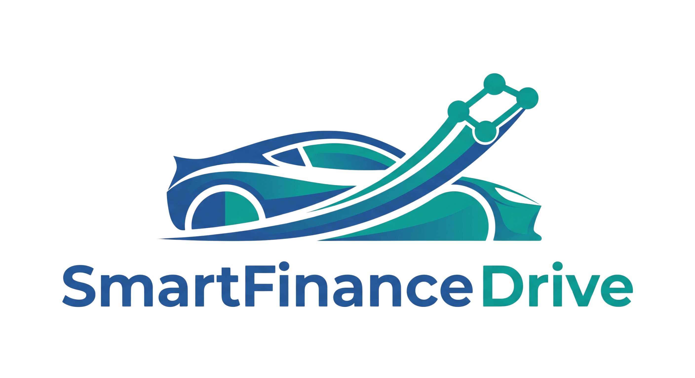
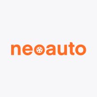
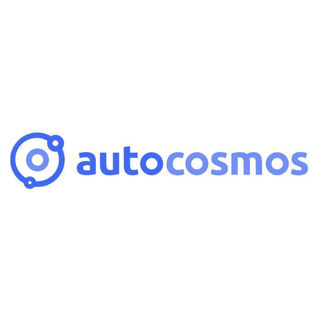

# Capítulo II: Requirements Elicitation & Analysis

## 2.1. Competidores

En esta sección se realiza la identificación y descripción de los principales competidores en el mercado automotriz peruano. Se ha detectado la ausencia de intermediarios tecnológicos exclusivos para concesionarias formales, por lo que se contrastará la propuesta de SmartFinance Drive frente a portales de clasificados genéricos, catálogos informativos y disruptores del modelo de inventario.

### 2.1.1. Análisis competitivo

**Competitive Analysis Landscape**

| ¿Por qué llevar a cabo este análisis? | Identificar la ausencia de intermediarios tecnológicos exclusivos para concesionarias en el mercado peruano y contrastar nuestra propuesta frente a portales genéricos, catálogos informativos y disruptores de inventario, validando a SmartFinance Drive como la única solución B2B2C integral. |
| :------------------------------------- | :----------------------------------------------------------------------------------------------------------------------------------------------------------------------------------------------------------------------------------------------------------------------------------------------- |

| Criterio | SmartFinance Drive   {width=50px} | NeoAuto   {width=50px} | Autocosmos Perú   {width=50px} | Kavak Perú   {width=50px} |
| :----------------------------------------- | :----------------------------------: | :----------------------------------: | :----------------------------------: | :----------------------------------: |
| **Perfil:** Overview | Marketplace B2B2C que actúa como intermediario tecnológico exclusivo entre concesionarias formales y clientes, que unifica vehículos nuevos y usados con simulación de crédito multi-banco, pre-evaluación de riesgo y evaluación oficial por la entidad financiera. | Portal generalista de avisos clasificados donde publican tanto usuarios particulares (C2C) como concesionarias (B2C). | Portal especializado en contenido automotriz y catálogo de vehículos **0 km**, sirviendo como puente técnico entre el usuario y las marcas. | Startup que opera como una concesionaria digital propia. Compran vehículos a particulares, los reacondicionan y los venden. |
| **Perfil:** Ventaja competitiva ¿Qué valor ofrece a los clientes? | Exclusividad para inventarios formales, comparador de vehículos y de entidades financieras, simulación de crédito multi-banco con pre-evaluación de riesgo y evaluación oficial por el banco, y entrega a la concesionaria de los datos de contacto de los clientes que simularon sobre sus vehículos. | Tráfico orgánico masivo y gran visibilidad. Las concesionarias lo usan como vitrina comprando "paquetes corporativos". | Enfoque exclusivo en vehículos nuevos. Ofrece cotizadores oficiales y reseñas detalladas, derivando al cliente a la marca. | Control total del proceso. Ofrecen garantías mecánicas propias y financiamiento directo al ser dueños de su inventario. |
| **Perfil de Marketing:** Mercado objetivo | Concesionarias (B2B) con inventario estancado y compradores de vehículos nuevos y usados que buscan agilidad y transparencia financiera. | Público masivo. Atiende tanto al particular que quiere vender su auto como a la agencia que busca visibilidad general. | Compradores analíticos que buscan exclusivamente vehículos cero kilómetros y comparar especificaciones técnicas. | Compradores de vehículos seminuevos que desconfían de los vendedores informales y buscan garantías de fábrica. |
| **Perfil de Marketing:** Estrategias de marketing | Cobro de membresías B2B bajo la promesa de mayor exposición del inventario, estadísticas de vistas y simulaciones por vehículo y contacto con clientes interesados, apoyando la rotación de inventario. | Pauta publicitaria masiva y venta de tiendas virtuales ("NeoTiendas") para agencias dentro de su ecosistema. | Alianzas con marcas importadoras (Toyota, Kia, etc.) y generación de contenido editorial automotriz para atraer tráfico. | Fuerte inversión en marketing digital e infraestructura física (Hubs) para transmitir seguridad al comprador final. |
| **Perfil de Producto:** Productos & Servicios | Marketplace unificado de vehículos nuevos y usados con búsqueda y filtros, comparador de vehículos y de entidades financieras, simulación de crédito multi-banco, pre-evaluación de riesgo, evaluación oficial por la entidad financiera y panel de estadísticas para concesionarias. | Publicación de clasificados, banners de publicidad bancaria (sin evaluación real integrada) y cotizadores de seguros. | Fichas técnicas, comparador de vehículos nuevos, noticias del sector y derivación de leads a la concesionaria. | Compra inmediata del auto al usuario, venta de su propio catálogo certificado, financiamiento interno y postventa. |
| **Perfil de Producto:** Precios & Costos | Modelo de monetización B2B, cobrando una membresía recurrente a las concesionarias que deseen listar sus vehículos. | Costo por paquete de publicación (básico a súper destacado) para particulares y tarifas corporativas para agencias. | Gratuito para el usuario; monetiza cobrando a las marcas automotrices por pauta publicitaria y derivación de leads. | Ganancia proveniente del margen comercial entre el precio de compra del vehículo usado y su precio de venta reacondicionado. |
| **Perfil de Producto:** Canales de distribución (Web y/o Móvil) | Plataforma web para todos los roles y app móvil (Android) de mensajería entre clientes, concesionarias y entidades financieras. | Web responsiva y aplicación móvil consolidada en el mercado peruano. | Principalmente portal web responsivo y canal de YouTube para reseñas. | Plataforma web, aplicación móvil y enormes sedes físicas de exhibición (Hubs). |
| **Análisis SWOT:** Fortalezas | Marketplace unificado de vehículos nuevos y usados que integra comparadores, pre-evaluación de riesgo y simulación de crédito multi-banco en un solo lugar, con la decisión crediticia a cargo de la entidad financiera. | Base de usuarios gigante y posicionamiento dominante (SEO y Top of Mind) en el mercado peruano. | Especialización profunda en el nicho de vehículos nuevos, con herramientas de comparación técnica muy valoradas. | Control de calidad exhaustivo sobre su stock y capacidad de ofrecer financiamiento inmediato con recursos propios. |
| **Análisis SWOT:** Debilidades | Al ser una startup nueva, carece del tráfico orgánico, historial y posicionamiento de marca que poseen sus competidores. | Genera un alto volumen de leads "fríos" o sin capacidad crediticia demostrada para las concesionarias. | Su modelo ignora por completo el mercado de vehículos usados, limitando su alcance de usuarios. | Altos costos operativos y logísticos debido a la necesidad de mantener infraestructura física y stock propio. |
| **Análisis SWOT:** Oportunidades | Devaluación acelerada del inventario automotriz actual y fricción bancaria que frustra a los compradores. | Integrar simuladores de crédito o cerrar acuerdos directos con bancos para mejorar la calidad de sus contactos comerciales. | Ampliar su catálogo y herramientas informativas hacia el creciente mercado de los vehículos seminuevos. | Aprovechar la desconfianza general en el mercado informal peruano para captar más compradores temerosos. |
| **Análisis SWOT:** Amenazas | Alta fidelidad de los usuarios a plataformas establecidas y el riesgo de que los gigantes repliquen las funciones de simulación y comparación financiera. | Surgimiento de marketplaces B2B2C de nicho que ofrezcan mejor ROI a las concesionarias. | Plataformas de clasificados que mejoren sus filtros y fichas técnicas, reduciendo la necesidad de un portal especializado. | Regulaciones financieras más estrictas o fluctuaciones del mercado automotriz que devalúen su inventario propio. |

### 2.1.2. Estrategias y tácticas frente a competidores

Para afrontar este entorno competitivo, SmartFinance Drive aplicará una estrategia de diferenciación radical enfocada en **la calidad y la conversión**. En lugar de competir por un volumen masivo de tráfico como NeoAuto, explotaremos nuestra propuesta de valor para reducir drásticamente el tiempo que los clientes invierten buscando un auto. 

Aprovechando la gran oportunidad del inventario estancado en las concesionarias donde un auto se devalúa un 20% al segundo año, mitigaremos la amenaza de la fidelidad a plataformas tradicionales ofreciendo a las concesionarias exposición de su inventario, estadísticas de vistas y simulaciones por vehículo, y los datos de contacto de los clientes que simularon un crédito sobre sus vehículos con una pre-evaluación de riesgo previa, mientras la evaluación oficial queda a cargo de la entidad financiera. Esta táctica justifica el cobro de la membresía B2B y ataca la principal debilidad de la competencia: la generación de contactos "fríos" que hacen perder tiempo a los equipos de ventas.
