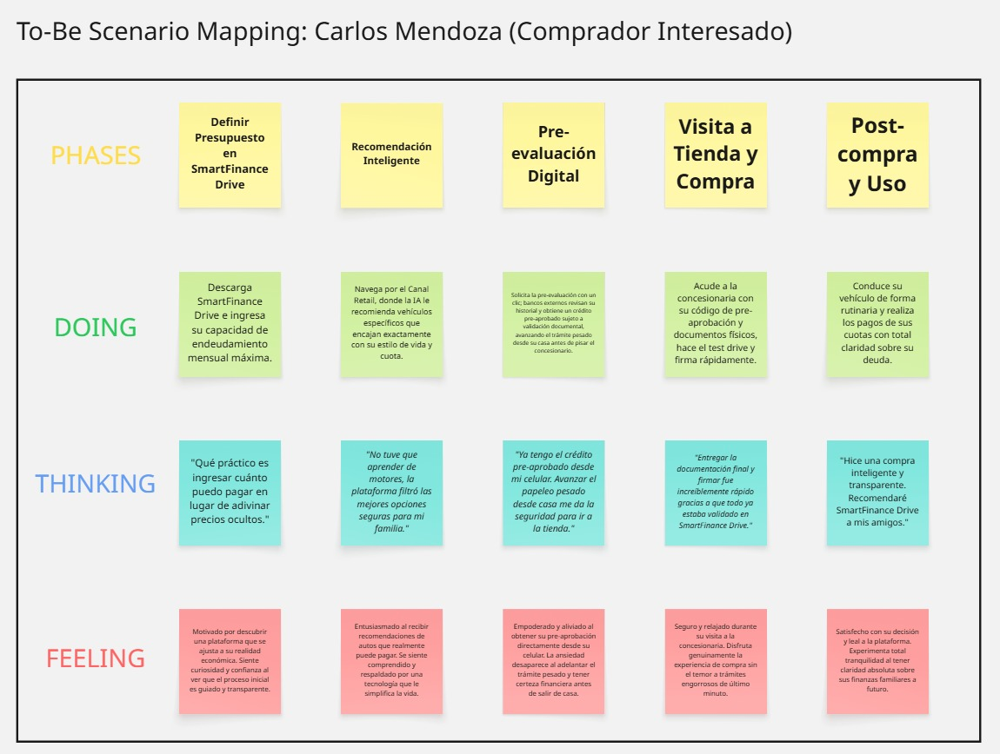
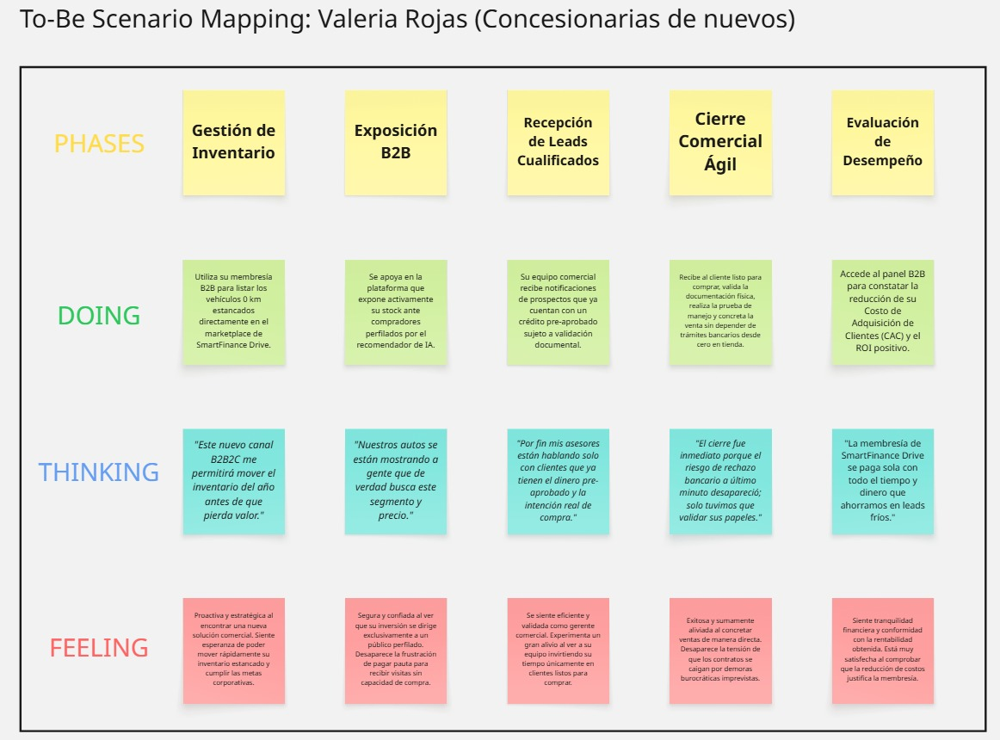
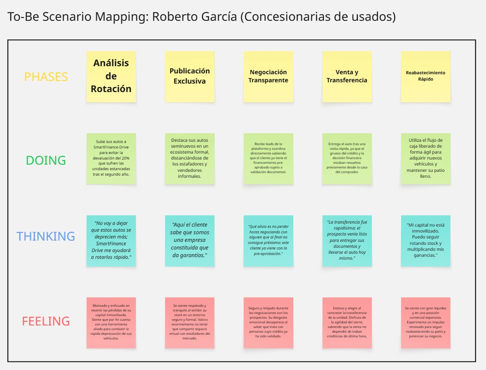
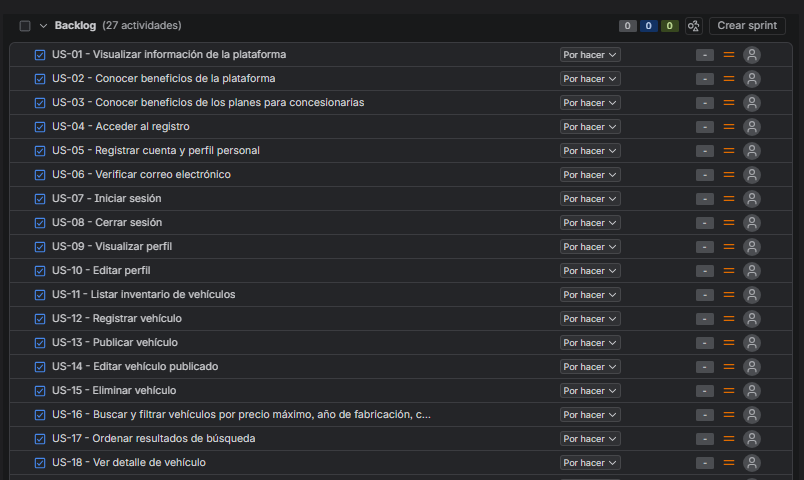
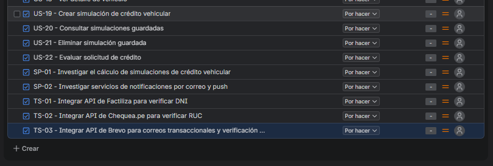
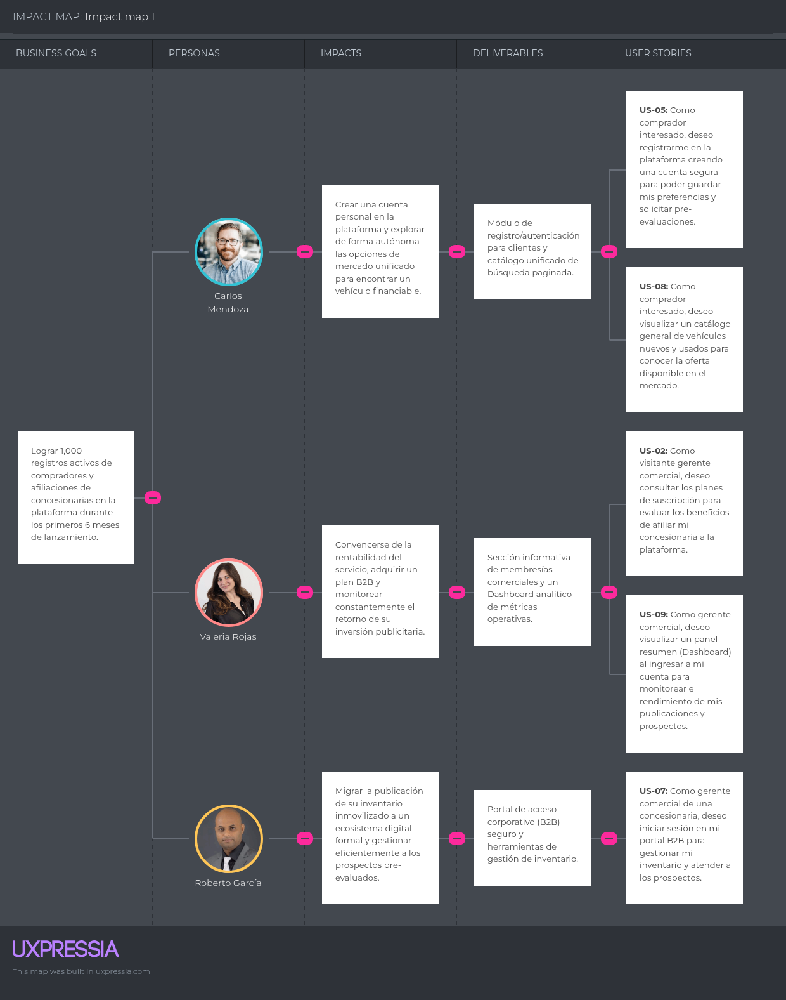

# Capítulo III: Requirements Specification

## 3.1. To-Be Scenario Mapping

**Segmento 1: Compradores interesados**

**Segmento 2: Concesionarias de vehículos nuevos**

**Segmento 3: Concesionarias de vehículos usados**

* **Enlace interactivo del tablero en Miro:** [https://miro.com/app/board/uXjVHpkhWe4=/?share_link_id=221895309503](https://miro.com/app/board/uXjVHpkhWe4=/?share_link_id=221895309503)

## 3.2. User Stories

En esta sección se definen los requisitos funcionales, no funcionales y técnicos de SmartFinance Drive mediante un conjunto estructurado de User Stories organizadas por plataforma. Las historias identificadas como **(Web)** (LP-01 a LP-04 y US01 a US39) describen la Landing Page y la aplicación web para los cuatro roles de la plataforma (Cliente, Concesionario, Entidad Financiera y Administrador). Las historias identificadas como **(Mobile)** (US40 a US49) describen la aplicación móvil Android, cuyo alcance es el inicio y cierre de sesión y la mensajería entre clientes, concesionarias y entidades financieras. Las historias técnicas (SP y TS) corresponden al backend.

### Historias de la Landing Page y la aplicación web (Web)

**LP-01 — Visualizar información de la plataforma (Web)**

+---------------------------+--------------------------------------------------------------------------------------+
| Campo                     | Detalle                                                                              |
+===========================+======================================================================================+
| **User**                  | Visitante                                                                            |
+---------------------------+--------------------------------------------------------------------------------------+
| **Platform**              | Web (Landing Page)                                                                   |
+---------------------------+--------------------------------------------------------------------------------------+
| **Priority**              | Alta                                                                                 |
+---------------------------+--------------------------------------------------------------------------------------+
| **Epic**                  | Landing Page y captación                                                             |
+---------------------------+--------------------------------------------------------------------------------------+
| **Description**           | Como Visitante, quiero visualizar información general de la plataforma, para conocer |
|                           | su propósito, funcionamiento y propuesta de valor antes de registrarme.              |
+---------------------------+--------------------------------------------------------------------------------------+
| **Acceptance Criteria**   | **Escenario 1 — Visualización de información**\                                      |
|                           | **Dado** que el visitante accede a la plataforma,\                                   |
|                           | **Cuando** consulta la información general del servicio,\                            |
|                           | **Entonces** puede visualizar información general sobre la plataforma y sus\         |
|                           | principales funcionalidades.\                                                        |
|                           | \                                                                                    |
|                           | **Escenario 2 — Navegación de información**\                                         |
|                           | **Dado** que el visitante consulta la información de la plataforma,\                 |
|                           | **Cuando** explora sus diferentes contenidos y servicios,\                           |
|                           | **Entonces** puede acceder a la información presentada de manera clara y organizada. |
+---------------------------+--------------------------------------------------------------------------------------+

 

**LP-02 — Conocer beneficios de la plataforma (Web)**

+---------------------------+--------------------------------------------------------------------------------------+
| Campo                     | Detalle                                                                              |
+===========================+======================================================================================+
| **User**                  | Visitante                                                                            |
+---------------------------+--------------------------------------------------------------------------------------+
| **Platform**              | Web (Landing Page)                                                                   |
+---------------------------+--------------------------------------------------------------------------------------+
| **Priority**              | Alta                                                                                 |
+---------------------------+--------------------------------------------------------------------------------------+
| **Epic**                  | Landing Page y captación                                                             |
+---------------------------+--------------------------------------------------------------------------------------+
| **Description**           | Como Visitante, quiero conocer los beneficios de utilizar la plataforma, para        |
|                           | comprender cómo puede facilitar la búsqueda y gestión de opciones de financiamiento  |
|                           | vehicular.                                                                           |
+---------------------------+--------------------------------------------------------------------------------------+
| **Acceptance Criteria**   | **Escenario 1 — Visualización de beneficios**\                                       |
|                           | **Dado** que el visitante accede a la plataforma,\                                   |
|                           | **Cuando** consulta los beneficios de la solución,\                                  |
|                           | **Entonces** puede visualizar los principales beneficios ofrecidos por la\           |
|                           | plataforma.\                                                                         |
|                           | \                                                                                    |
|                           | **Escenario 2 — Información comprensible**\                                          |
|                           | **Dado** que el visitante revisa los beneficios,\                                    |
|                           | **Cuando** analiza cada propuesta de valor,\                                         |
|                           | **Entonces** la información se presenta de forma clara y comprensible.               |
+---------------------------+--------------------------------------------------------------------------------------+

 

**LP-03 — Conocer beneficios de los planes para concesionarias (Web)**

+---------------------------+--------------------------------------------------------------------------------------+
| Campo                     | Detalle                                                                              |
+===========================+======================================================================================+
| **User**                  | Visitante                                                                            |
+---------------------------+--------------------------------------------------------------------------------------+
| **Platform**              | Web (Landing Page)                                                                   |
+---------------------------+--------------------------------------------------------------------------------------+
| **Priority**              | Alta                                                                                 |
+---------------------------+--------------------------------------------------------------------------------------+
| **Epic**                  | Landing Page y captación                                                             |
+---------------------------+--------------------------------------------------------------------------------------+
| **Description**           | Como Visitante, quiero conocer los beneficios de los planes disponibles, para        |
|                           | identificar qué opción se adapta a las necesidades de una concesionaria.             |
+---------------------------+--------------------------------------------------------------------------------------+
| **Acceptance Criteria**   | **Escenario 1 — Visualización de planes**\                                           |
|                           | **Dado** que el visitante requiere evaluar las opciones de suscripción,\             |
|                           | **Cuando** consulta los planes comerciales disponibles,\                             |
|                           | **Entonces** puede visualizar los planes ofrecidos y sus principales\                |
|                           | características.\                                                                    |
|                           | \                                                                                    |
|                           | **Escenario 2 — Comparación de beneficios**\                                         |
|                           | **Dado** que existen diferentes planes de membresía,\                                |
|                           | **Cuando** el visitante compara sus características y coberturas,\                   |
|                           | **Entonces** puede identificar las diferencias entre sus beneficios.                 |
+---------------------------+--------------------------------------------------------------------------------------+

 

**LP-04 — Acceder al registro (Web)**

+---------------------------+--------------------------------------------------------------------------------------+
| Campo                     | Detalle                                                                              |
+===========================+======================================================================================+
| **User**                  | Visitante                                                                            |
+---------------------------+--------------------------------------------------------------------------------------+
| **Platform**              | Web (Landing Page)                                                                   |
+---------------------------+--------------------------------------------------------------------------------------+
| **Priority**              | Alta                                                                                 |
+---------------------------+--------------------------------------------------------------------------------------+
| **Epic**                  | Landing Page y captación                                                             |
+---------------------------+--------------------------------------------------------------------------------------+
| **Description**           | Como Visitante, quiero acceder al registro desde la plataforma, para crear una       |
|                           | cuenta y utilizar sus funcionalidades.                                               |
+---------------------------+--------------------------------------------------------------------------------------+
| **Acceptance Criteria**   | **Escenario 1 — Acceso al registro**\                                                |
|                           | **Dado** que el visitante no cuenta con una cuenta registrada,\                      |
|                           | **Cuando** solicita registrarse en la plataforma,\                                   |
|                           | **Entonces** la plataforma inicia el proceso de registro de cuenta.\                 |
|                           | \                                                                                    |
|                           | **Escenario 2 — Inicio del registro**\                                               |
|                           | **Dado** que el visitante inicia el proceso de registro,\                            |
|                           | **Cuando** proporciona los datos requeridos para la creación de cuenta,\             |
|                           | **Entonces** puede ingresar la información necesaria para registrarse.               |
+---------------------------+--------------------------------------------------------------------------------------+

 

**US01 — Registro de cuenta (Web)**

+---------------------------+--------------------------------------------------------------------------------------+
| Campo                     | Detalle                                                                              |
+===========================+======================================================================================+
| **User**                  | Visitante                                                                            |
+---------------------------+--------------------------------------------------------------------------------------+
| **Platform**              | Web                                                                                  |
+---------------------------+--------------------------------------------------------------------------------------+
| **Priority**              | Alta                                                                                 |
+---------------------------+--------------------------------------------------------------------------------------+
| **Epic**                  | Gestión de acceso y cuenta                                                           |
+---------------------------+--------------------------------------------------------------------------------------+
| **Description**           | Como Visitante, quiero crear una cuenta con correo y contraseña desde la aplicación  |
|                           | web, para poder acceder a las funcionalidades de la plataforma.                      |
+---------------------------+--------------------------------------------------------------------------------------+
| **Acceptance Criteria**   | **Escenario 1 — Registro exitoso**\                                                  |
|                           | **Dado** que ingreso a la página web de registro,\                                   |
|                           | **Cuando** envío un correo válido y una contraseña que cumple la política de         |
|                           | seguridad,\                                                                          |
|                           | **Entonces** el sistema crea mi cuenta con el rol ROLE_USER y me redirige al         |
|                           | dashboard.\                                                                          |
|                           | \                                                                                    |
|                           | **Escenario 2 — Correo ya registrado**\                                              |
|                           | **Dado** que el correo ingresado ya existe en el sistema,\                           |
|                           | **Cuando** intento registrarme,\                                                     |
|                           | **Entonces** el sistema muestra un mensaje de error indicando que el correo ya está  |
|                           | en uso.                                                                              |
+---------------------------+--------------------------------------------------------------------------------------+

 

**US02 — Inicio de sesión (Web)**

+---------------------------+--------------------------------------------------------------------------------------+
| Campo                     | Detalle                                                                              |
+===========================+======================================================================================+
| **User**                  | Usuario registrado                                                                   |
+---------------------------+--------------------------------------------------------------------------------------+
| **Platform**              | Web                                                                                  |
+---------------------------+--------------------------------------------------------------------------------------+
| **Priority**              | Alta                                                                                 |
+---------------------------+--------------------------------------------------------------------------------------+
| **Epic**                  | Gestión de acceso y cuenta                                                           |
+---------------------------+--------------------------------------------------------------------------------------+
| **Description**           | Como persona con una cuenta registrada en la plataforma (cliente, concesionario o    |
|                           | entidad financiera), quiero iniciar sesión desde la aplicación web con mis           |
|                           | credenciales, para acceder a mi panel personalizado según mi rol.                    |
+---------------------------+--------------------------------------------------------------------------------------+
| **Acceptance Criteria**   | **Escenario 1 — Credenciales correctas**\                                            |
|                           | **Dado** que tengo una cuenta registrada,\                                           |
|                           | **Cuando** ingreso mi correo y contraseña correctos en la web,\                      |
|                           | **Entonces** recibo un token de acceso y soy redirigido a mi dashboard               |
|                           | correspondiente a mi rol.\                                                           |
|                           | \                                                                                    |
|                           | **Escenario 2 — Credenciales incorrectas**\                                          |
|                           | **Dado** que ingreso una contraseña incorrecta,\                                     |
|                           | **Cuando** envío el formulario de login,\                                            |
|                           | **Entonces** el sistema muestra un mensaje de error sin indicar si el correo existe  |
|                           | o no.                                                                                |
+---------------------------+--------------------------------------------------------------------------------------+

 

**US03 — Cierre de sesión (Web)**

+---------------------------+--------------------------------------------------------------------------------------+
| Campo                     | Detalle                                                                              |
+===========================+======================================================================================+
| **User**                  | Usuario autenticado                                                                  |
+---------------------------+--------------------------------------------------------------------------------------+
| **Platform**              | Web                                                                                  |
+---------------------------+--------------------------------------------------------------------------------------+
| **Priority**              | Alta                                                                                 |
+---------------------------+--------------------------------------------------------------------------------------+
| **Epic**                  | Gestión de acceso y cuenta                                                           |
+---------------------------+--------------------------------------------------------------------------------------+
| **Description**           | Como Persona autenticada en la plataforma (cliente, concesionario o entidad          |
|                           | financiera), quiero cerrar sesión desde cualquier pantalla web, para proteger el     |
|                           | acceso a mi cuenta.                                                                  |
+---------------------------+--------------------------------------------------------------------------------------+
| **Acceptance Criteria**   | **Escenario 1**\                                                                     |
|                           | **Dado** que estoy autenticado en la web,\                                           |
|                           | **Cuando** presiono "Cerrar sesión",\                                                |
|                           | **Entonces** mi token se inválida en el cliente y soy redirigido a la página de      |
|                           | login.                                                                               |
+---------------------------+--------------------------------------------------------------------------------------+

 

**US04 — Solicitud de rol Concesionario (Web)**

+---------------------------+--------------------------------------------------------------------------------------+
| Campo                     | Detalle                                                                              |
+===========================+======================================================================================+
| **User**                  | Usuario registrado                                                                   |
+---------------------------+--------------------------------------------------------------------------------------+
| **Platform**              | Web                                                                                  |
+---------------------------+--------------------------------------------------------------------------------------+
| **Priority**              | Alta                                                                                 |
+---------------------------+--------------------------------------------------------------------------------------+
| **Epic**                  | Gestión de perfil y roles                                                            |
+---------------------------+--------------------------------------------------------------------------------------+
| **Description**           | Como Usuario recién registrado (aún sin rol asignado más allá de ROLE_USER), quiero  |
|                           | solicitar el rol de concesionario ingresando mi RUC desde la web, para poder         |
|                           | publicar vehículos en el catálogo.                                                   |
+---------------------------+--------------------------------------------------------------------------------------+
| **Acceptance Criteria**   | **Escenario 1 — RUC válido**\                                                        |
|                           | **Dado** que ingreso un RUC activo, habido y con CIIU 451xx,\                        |
|                           | **Cuando** envío la solicitud de elevación,\                                         |
|                           | **Entonces** mi cuenta obtiene el rol ROLE_DEALER de forma inmediata.\               |
|                           | \                                                                                    |
|                           | **Escenario 2 — RUC no califica**\                                                   |
|                           | **Dado** que el RUC no está activo o su CIIU no corresponde a venta de vehículos,\   |
|                           | **Cuando** envío la solicitud,\                                                      |
|                           | **Entonces** el sistema muestra un error explicando la causa del rechazo.            |
+---------------------------+--------------------------------------------------------------------------------------+

 

**US05 — Solicitud de rol Entidad Financiera (Web)**

+---------------------------+--------------------------------------------------------------------------------------+
| Campo                     | Detalle                                                                              |
+===========================+======================================================================================+
| **User**                  | Usuario registrado                                                                   |
+---------------------------+--------------------------------------------------------------------------------------+
| **Platform**              | Web                                                                                  |
+---------------------------+--------------------------------------------------------------------------------------+
| **Priority**              | Alta                                                                                 |
+---------------------------+--------------------------------------------------------------------------------------+
| **Epic**                  | Gestión de perfil y roles                                                            |
+---------------------------+--------------------------------------------------------------------------------------+
| **Description**           | Como Usuario recién registrado (aún sin rol asignado más allá de ROLE_USER), quiero  |
|                           | solicitar el rol de entidad financiera ingresando mi RUC desde la web, para poder    |
|                           | gestionar productos y tasas en la plataforma.                                        |
+---------------------------+--------------------------------------------------------------------------------------+
| **Acceptance Criteria**   | **Escenario 1 — RUC válido**\                                                        |
|                           | **Dado** que ingreso un RUC activo, habido y con CIIU 64xx o 66xx,\                  |
|                           | **Cuando** envío la solicitud,\                                                      |
|                           | **Entonces** mi cuenta obtiene el rol ROLE_FINANCIAL_INSTITUTION.\                   |
|                           | \                                                                                    |
|                           | **Escenario 2 — RUC inválido**\                                                      |
|                           | **Dado** que el RUC no cumple las condiciones,\                                      |
|                           | **Cuando** envío la solicitud,\                                                      |
|                           | **Entonces** el sistema rechaza la petición con un mensaje claro.                    |
+---------------------------+--------------------------------------------------------------------------------------+

 

**US06 — Registro de perfil socioeconómico (Web)**

+---------------------------+--------------------------------------------------------------------------------------+
| Campo                     | Detalle                                                                              |
+===========================+======================================================================================+
| **User**                  | Cliente                                                                              |
+---------------------------+--------------------------------------------------------------------------------------+
| **Platform**              | Web                                                                                  |
+---------------------------+--------------------------------------------------------------------------------------+
| **Priority**              | Alta                                                                                 |
+---------------------------+--------------------------------------------------------------------------------------+
| **Epic**                  | Gestión de perfil y roles                                                            |
+---------------------------+--------------------------------------------------------------------------------------+
| **Description**           | Como Cliente, quiero completar mi perfil con datos personales, de contacto e         |
|                           | ingresos desde la web, para poder acceder a simulaciones y evaluaciones crediticias. |
+---------------------------+--------------------------------------------------------------------------------------+
| **Acceptance Criteria**   | **Escenario 1**\                                                                     |
|                           | **Dado** que aún no tengo un perfil creado,\                                         |
|                           | **Cuando** completo nombre, tipo y número de documento, correo, teléfono e ingreso   |
|                           | mensual,\                                                                            |
|                           | **Entonces** el sistema guarda mi perfil y habilita las secciones de scoring y       |
|                           | simulación.\                                                                         |
|                           | \                                                                                    |
|                           | **Escenario 2 — Campos obligatorios faltantes**\                                     |
|                           | **Dado** que dejo el correo vacío,\                                                  |
|                           | **Cuando** intento guardar el perfil,\                                               |
|                           | **Entonces** el sistema me impide continuar y resalta el campo faltante.             |
+---------------------------+--------------------------------------------------------------------------------------+

 

**US07 — Edición de perfil (Web)**

+---------------------------+--------------------------------------------------------------------------------------+
| Campo                     | Detalle                                                                              |
+===========================+======================================================================================+
| **User**                  | Cliente                                                                              |
+---------------------------+--------------------------------------------------------------------------------------+
| **Platform**              | Web                                                                                  |
+---------------------------+--------------------------------------------------------------------------------------+
| **Priority**              | Media                                                                                |
+---------------------------+--------------------------------------------------------------------------------------+
| **Epic**                  | Gestión de perfil y roles                                                            |
+---------------------------+--------------------------------------------------------------------------------------+
| **Description**           | Como Cliente, quiero actualizar mis datos de contacto e ingresos desde la web, para  |
|                           | mantener mi información vigente en la plataforma.                                    |
+---------------------------+--------------------------------------------------------------------------------------+
| **Acceptance Criteria**   | **Escenario 1**\                                                                     |
|                           | **Dado** que tengo un perfil existente,\                                             |
|                           | **Cuando** modifico mi teléfono o ingreso mensual y guardo,\                         |
|                           | **Entonces** el sistema actualiza los datos y los refleja en mi panel.               |
+---------------------------+--------------------------------------------------------------------------------------+

 

**US08 — Búsqueda y filtrado de vehículos (Web)**

+---------------------------+--------------------------------------------------------------------------------------+
| Campo                     | Detalle                                                                              |
+===========================+======================================================================================+
| **User**                  | Cliente                                                                              |
+---------------------------+--------------------------------------------------------------------------------------+
| **Platform**              | Web                                                                                  |
+---------------------------+--------------------------------------------------------------------------------------+
| **Priority**              | Alta                                                                                 |
+---------------------------+--------------------------------------------------------------------------------------+
| **Epic**                  | Exploración y búsqueda de vehículos                                                  |
+---------------------------+--------------------------------------------------------------------------------------+
| **Description**           | Como Cliente, quiero buscar vehículos por marca, precio máximo, año y condición      |
|                           | desde la web, para encontrar opciones acordes a mi presupuesto.                      |
+---------------------------+--------------------------------------------------------------------------------------+
| **Acceptance Criteria**   | **Escenario 1 — Resultados encontrados**\                                            |
|                           | **Dado** que estoy en la sección de catálogo,\                                       |
|                           | **Cuando** filtro por marca "Toyota" y precio máximo 30000,\                         |
|                           | **Entonces** el sistema muestra únicamente vehículos que cumplen ambos filtros.\     |
|                           | \                                                                                    |
|                           | **Escenario 2 — Sin resultados**\                                                    |
|                           | **Dado** que los filtros no coinciden con ningún vehículo,\                          |
|                           | **Cuando** aplico la búsqueda,\                                                      |
|                           | **Entonces** el sistema muestra un mensaje indicando que no hay resultados.          |
+---------------------------+--------------------------------------------------------------------------------------+

 

**US09 — Ver detalle de un vehículo (Web)**

+---------------------------+--------------------------------------------------------------------------------------+
| Campo                     | Detalle                                                                              |
+===========================+======================================================================================+
| **User**                  | Cliente                                                                              |
+---------------------------+--------------------------------------------------------------------------------------+
| **Platform**              | Web                                                                                  |
+---------------------------+--------------------------------------------------------------------------------------+
| **Priority**              | Alta                                                                                 |
+---------------------------+--------------------------------------------------------------------------------------+
| **Epic**                  | Exploración y búsqueda de vehículos                                                  |
+---------------------------+--------------------------------------------------------------------------------------+
| **Description**           | Como Cliente, quiero ver el detalle completo de un vehículo (precio, año,            |
|                           | motorización, concesionaria) desde la web, para decidir si me conviene simular un    |
|                           | crédito con el.                                                                      |
+---------------------------+--------------------------------------------------------------------------------------+
| **Acceptance Criteria**   | **Escenario 1**\                                                                     |
|                           | **Dado** que selecciono un vehículo del listado,\                                    |
|                           | **Cuando** accedo a su página de detalle,\                                           |
|                           | **Entonces** veo toda su ficha técnica, precio autoritativo y la opción de iniciar   |
|                           | una simulación.                                                                      |
+---------------------------+--------------------------------------------------------------------------------------+

 

**US10 — Publicar vehículo en el catálogo (Web)**

+---------------------------+--------------------------------------------------------------------------------------+
| Campo                     | Detalle                                                                              |
+===========================+======================================================================================+
| **User**                  | Concesionario                                                                        |
+---------------------------+--------------------------------------------------------------------------------------+
| **Platform**              | Web                                                                                  |
+---------------------------+--------------------------------------------------------------------------------------+
| **Priority**              | Alta                                                                                 |
+---------------------------+--------------------------------------------------------------------------------------+
| **Epic**                  | Gestión de inventario de vehículos                                                   |
+---------------------------+--------------------------------------------------------------------------------------+
| **Description**           | Como Concesionario, quiero publicar un vehículo con sus datos y precio desde mi      |
|                           | panel web, para ofrecerlo a los clientes de la plataforma.                           |
+---------------------------+--------------------------------------------------------------------------------------+
| **Acceptance Criteria**   | **Escenario 1**\                                                                     |
|                           | **Dado** que tengo el rol ROLE_DEALER,\                                              |
|                           | **Cuando** completo el formulario de publicación con datos válidos,\                 |
|                           | **Entonces** el vehículo aparece en el catálogo público.\                            |
|                           | \                                                                                    |
|                           | **Escenario 2 — Sin rol Dealer**\                                                    |
|                           | **Dado** que solo tengo ROLE_USER,\                                                  |
|                           | **Cuando** intento acceder al formulario de publicación,\                            |
|                           | **Entonces** el sistema bloquea el acceso y sugiere solicitar el rol de              |
|                           | concesionario.                                                                       |
+---------------------------+--------------------------------------------------------------------------------------+

 

**US11 — Editar vehículo publicado (Web)**

+---------------------------+--------------------------------------------------------------------------------------+
| Campo                     | Detalle                                                                              |
+===========================+======================================================================================+
| **User**                  | Concesionario                                                                        |
+---------------------------+--------------------------------------------------------------------------------------+
| **Platform**              | Web                                                                                  |
+---------------------------+--------------------------------------------------------------------------------------+
| **Priority**              | Media                                                                                |
+---------------------------+--------------------------------------------------------------------------------------+
| **Epic**                  | Gestión de inventario de vehículos                                                   |
+---------------------------+--------------------------------------------------------------------------------------+
| **Description**           | Como Concesionario, quiero actualizar el precio y stock de un vehículo que publique  |
|                           | desde mi panel web, para mantener el catálogo al día.                                |
+---------------------------+--------------------------------------------------------------------------------------+
| **Acceptance Criteria**   | **Escenario 1**\                                                                     |
|                           | **Dado** que soy dueño de la publicación,\                                           |
|                           | **Cuando** modifico el precio y guardo,\                                             |
|                           | **Entonces** el catálogo refleja el nuevo precio inmediatamente.                     |
+---------------------------+--------------------------------------------------------------------------------------+

 

**US12 — Eliminar vehículo del catálogo (Web)**

+---------------------------+--------------------------------------------------------------------------------------+
| Campo                     | Detalle                                                                              |
+===========================+======================================================================================+
| **User**                  | Concesionario                                                                        |
+---------------------------+--------------------------------------------------------------------------------------+
| **Platform**              | Web                                                                                  |
+---------------------------+--------------------------------------------------------------------------------------+
| **Priority**              | Media                                                                                |
+---------------------------+--------------------------------------------------------------------------------------+
| **Epic**                  | Gestión de inventario de vehículos                                                   |
+---------------------------+--------------------------------------------------------------------------------------+
| **Description**           | Como Concesionario, quiero eliminar un vehículo que ya no está disponible desde mi   |
|                           | panel web, para que los clientes no lo vean como opción vigente.                     |
+---------------------------+--------------------------------------------------------------------------------------+
| **Acceptance Criteria**   | **Escenario 1**\                                                                     |
|                           | **Dado** que selecciono "Eliminar" sobre un vehículo propio,\                        |
|                           | **Cuando** confirmo la acción,\                                                      |
|                           | **Entonces** el vehículo deja de aparecer en el catálogo.                            |
+---------------------------+--------------------------------------------------------------------------------------+

 

**US13 — Comparar entidades financieras (Web)**

+---------------------------+--------------------------------------------------------------------------------------+
| Campo                     | Detalle                                                                              |
+===========================+======================================================================================+
| **User**                  | Cliente                                                                              |
+---------------------------+--------------------------------------------------------------------------------------+
| **Platform**              | Web                                                                                  |
+---------------------------+--------------------------------------------------------------------------------------+
| **Priority**              | Alta                                                                                 |
+---------------------------+--------------------------------------------------------------------------------------+
| **Epic**                  | Entidades financieras y evaluación de solicitudes                                    |
+---------------------------+--------------------------------------------------------------------------------------+
| **Description**           | Como Cliente, quiero comparar las tasas TEA/TNA, cuota inicial mínima y seguros de   |
|                           | las entidades financieras disponibles desde la web, para elegir la opción más        |
|                           | conveniente antes de simular.                                                        |
+---------------------------+--------------------------------------------------------------------------------------+
| **Acceptance Criteria**   | **Escenario 1**\                                                                     |
|                           | **Dado** que estoy por iniciar una simulación,\                                      |
|                           | **Cuando** abro el comparador de entidades,\                                         |
|                           | **Entonces** veo un cuadro con tasas, cuota inicial y condiciones de cada banco      |
|                           | registrado.                                                                          |
+---------------------------+--------------------------------------------------------------------------------------+

 

**US14 — Registrar entidad financiera (Web)**

+---------------------------+--------------------------------------------------------------------------------------+
| Campo                     | Detalle                                                                              |
+===========================+======================================================================================+
| **User**                  | Entidad financiera                                                                   |
+---------------------------+--------------------------------------------------------------------------------------+
| **Platform**              | Web                                                                                  |
+---------------------------+--------------------------------------------------------------------------------------+
| **Priority**              | Alta                                                                                 |
+---------------------------+--------------------------------------------------------------------------------------+
| **Epic**                  | Entidades financieras y evaluación de solicitudes                                    |
+---------------------------+--------------------------------------------------------------------------------------+
| **Description**           | Como Entidad financiera, quiero registrar mi perfil con mis tasas y condiciones      |
|                           | vigentes desde la web, para aparecer como opción en las simulaciones de los          |
|                           | clientes.                                                                            |
+---------------------------+--------------------------------------------------------------------------------------+
| **Acceptance Criteria**   | **Escenario 1**\                                                                     |
|                           | **Dado** que tengo el rol ROLE_FINANCIAL_INSTITUTION,\                               |
|                           | **Cuando** completo el formulario con tasas min/max y comisiones,\                   |
|                           | **Entonces** mi entidad queda disponible en el comparador para los clientes.         |
+---------------------------+--------------------------------------------------------------------------------------+

 

**US15 — Generar pre-evaluación de riesgo crediticio (Web)**

+---------------------------+--------------------------------------------------------------------------------------+
| Campo                     | Detalle                                                                              |
+===========================+======================================================================================+
| **User**                  | Cliente                                                                              |
+---------------------------+--------------------------------------------------------------------------------------+
| **Platform**              | Web                                                                                  |
+---------------------------+--------------------------------------------------------------------------------------+
| **Priority**              | Alta                                                                                 |
+---------------------------+--------------------------------------------------------------------------------------+
| **Epic**                  | Simulación y seguimiento crediticio                                                  |
+---------------------------+--------------------------------------------------------------------------------------+
| **Description**           | Como Cliente, quiero generar mi pre-evaluación de score crediticio ingresando mis    |
|                           | ingresos y deudas actuales desde la web, para conocer mi capacidad de endeudamiento  |
|                           | antes de simular un crédito.                                                         |
+---------------------------+--------------------------------------------------------------------------------------+
| **Acceptance Criteria**   | **Escenario 1 — Aprobado**\                                                          |
|                           | **Dado** que mi ratio DTI es menor o igual a 30%,\                                   |
|                           | **Cuando** genero mi pre-evaluación,\                                                |
|                           | **Entonces** el sistema me muestra un score, categoría de riesgo Tier A y estado     |
|                           | APPROVED con mi capacidad máxima de endeudamiento.\                                  |
|                           | \                                                                                    |
|                           | **Escenario 2 — Rechazado**\                                                         |
|                           | **Dado** que mi ratio DTI supera el 45%,\                                            |
|                           | **Cuando** genero mi pre-evaluación,\                                                |
|                           | **Entonces** el sistema me muestra estado REJECTED con la razón del rechazo.         |
+---------------------------+--------------------------------------------------------------------------------------+

 

**US16 — Proyectar depreciación del vehículo (Web)**

+---------------------------+--------------------------------------------------------------------------------------+
| Campo                     | Detalle                                                                              |
+===========================+======================================================================================+
| **User**                  | Cliente                                                                              |
+---------------------------+--------------------------------------------------------------------------------------+
| **Platform**              | Web                                                                                  |
+---------------------------+--------------------------------------------------------------------------------------+
| **Priority**              | Media                                                                                |
+---------------------------+--------------------------------------------------------------------------------------+
| **Epic**                  | Simulación y seguimiento crediticio                                                  |
+---------------------------+--------------------------------------------------------------------------------------+
| **Description**           | Como Cliente, quiero ver la proyección de valor comercial de mi vehículo a 2, 3 y 5  |
|                           | años desde la web, para tomar una mejor decisión al vencimiento de mi crédito        |
|                           | (devolver, quedarme o vender).                                                       |
+---------------------------+--------------------------------------------------------------------------------------+
| **Acceptance Criteria**   | **Escenario 1**\                                                                     |
|                           | **Dado** que tengo una simulación activa para un vehículo,\                          |
|                           | **Cuando** solicito la proyección de depreciación,\                                  |
|                           | **Entonces** el sistema muestra el valor estimado del vehículo por año y lo compara  |
|                           | contra mi cuota balón, sugiriendo la mejor decisión.                                 |
+---------------------------+--------------------------------------------------------------------------------------+

 

**US17 — Crear simulación de crédito vehicular (Web)**

+---------------------------+--------------------------------------------------------------------------------------+
| Campo                     | Detalle                                                                              |
+===========================+======================================================================================+
| **User**                  | Cliente                                                                              |
+---------------------------+--------------------------------------------------------------------------------------+
| **Platform**              | Web                                                                                  |
+---------------------------+--------------------------------------------------------------------------------------+
| **Priority**              | Alta                                                                                 |
+---------------------------+--------------------------------------------------------------------------------------+
| **Epic**                  | Simulación y seguimiento crediticio                                                  |
+---------------------------+--------------------------------------------------------------------------------------+
| **Description**           | Como Cliente, quiero simular mi crédito indicando vehículo, entidad financiera,      |
|                           | cuota inicial y plazo desde la web, para conocer mi cuota mensual, TCEA y cronograma |
|                           | de pagos antes de comprometerme.                                                     |
+---------------------------+--------------------------------------------------------------------------------------+
| **Acceptance Criteria**   | **Escenario 1**\                                                                     |
|                           | **Dado** que seleccione un vehículo y una entidad financiera,\                       |
|                           | **Cuando** completo cuota inicial, plazo y tipo de amortización, y confirmo,\        |
|                           | **Entonces** el sistema genera el cronograma completo con cuota mensual, TIR, TCEA   |
|                           | y VAN.\                                                                              |
|                           | \                                                                                    |
|                           | **Escenario 2 — Datos inválidos**\                                                   |
|                           | **Dado** que ingreso una cuota inicial mayor al precio del vehículo,\                |
|                           | **Cuando** intento simular,\                                                         |
|                           | **Entonces** el sistema muestra un error de validación y no genera la simulación.    |
+---------------------------+--------------------------------------------------------------------------------------+

 

**US18 — Ver y eliminar simulaciones guardadas (Web)**

+---------------------------+--------------------------------------------------------------------------------------+
| Campo                     | Detalle                                                                              |
+===========================+======================================================================================+
| **User**                  | Cliente                                                                              |
+---------------------------+--------------------------------------------------------------------------------------+
| **Platform**              | Web                                                                                  |
+---------------------------+--------------------------------------------------------------------------------------+
| **Priority**              | Media                                                                                |
+---------------------------+--------------------------------------------------------------------------------------+
| **Epic**                  | Simulación y seguimiento crediticio                                                  |
+---------------------------+--------------------------------------------------------------------------------------+
| **Description**           | Como Cliente, quiero ver el historial de mis simulaciones y eliminar las que ya no   |
|                           | me interesan desde la web, para mantener organizado mi panel de financiamiento.      |
+---------------------------+--------------------------------------------------------------------------------------+
| **Acceptance Criteria**   | **Escenario 1**\                                                                     |
|                           | **Dado** que tengo simulaciones guardadas,\                                          |
|                           | **Cuando** accedo a "Mis simulaciones",\                                             |
|                           | **Entonces** veo el listado con su estado (pendiente/aprobado/rechazado).\           |
|                           | \                                                                                    |
|                           | **Escenario 2 — Eliminación**\                                                       |
|                           | **Dado** que elimino una simulación,\                                                |
|                           | **Cuando** confirmo la acción,\                                                      |
|                           | **Entonces** la simulación y su cronograma de pagos se eliminan permanentemente.     |
+---------------------------+--------------------------------------------------------------------------------------+

 

**US19 — Comparar cotizaciones multi-banco (Web)**

+---------------------------+--------------------------------------------------------------------------------------+
| Campo                     | Detalle                                                                              |
+===========================+======================================================================================+
| **User**                  | Cliente                                                                              |
+---------------------------+--------------------------------------------------------------------------------------+
| **Platform**              | Web                                                                                  |
+---------------------------+--------------------------------------------------------------------------------------+
| **Priority**              | Alta                                                                                 |
+---------------------------+--------------------------------------------------------------------------------------+
| **Epic**                  | Simulación y seguimiento crediticio                                                  |
+---------------------------+--------------------------------------------------------------------------------------+
| **Description**           | Como Cliente, quiero simular el mismo crédito bajo las condiciones de varias         |
|                           | entidades financieras a la vez desde la web, para elegir la oferta más conveniente   |
|                           | en un solo lugar.                                                                    |
+---------------------------+--------------------------------------------------------------------------------------+
| **Acceptance Criteria**   | **Escenario 1**\                                                                     |
|                           | **Dado** que tengo un vehículo y perfil seleccionados,\                              |
|                           | **Cuando** solicito la comparación multi-banco,\                                     |
|                           | **Entonces** el sistema muestra en un cuadro comparativo la cuota, TCEA y VAN de     |
|                           | cada entidad financiera registrada.                                                  |
+---------------------------+--------------------------------------------------------------------------------------+

 

**US20 — Modificar roles de usuario (Web)**

+---------------------------+--------------------------------------------------------------------------------------+
| Campo                     | Detalle                                                                              |
+===========================+======================================================================================+
| **User**                  | Administrador                                                                        |
+---------------------------+--------------------------------------------------------------------------------------+
| **Platform**              | Web                                                                                  |
+---------------------------+--------------------------------------------------------------------------------------+
| **Priority**              | Media                                                                                |
+---------------------------+--------------------------------------------------------------------------------------+
| **Epic**                  | Gestión de perfil y roles                                                            |
+---------------------------+--------------------------------------------------------------------------------------+
| **Description**           | Como Administrador, quiero modificar el rol de cualquier cuenta registrada desde mi  |
|                           | panel web, para gestionar excepciones (ej. asignar Analista Financiero) que no       |
|                           | siguen el flujo automático de SUNAT.                                                 |
+---------------------------+--------------------------------------------------------------------------------------+
| **Acceptance Criteria**   | **Escenario 1**\                                                                     |
|                           | **Dado** que tengo el rol ROLE_ADMIN,\                                               |
|                           | **Cuando** selecciono una cuenta y le asigno un nuevo rol,\                          |
|                           | **Entonces** el sistema actualiza sus permisos de inmediato.\                        |
|                           | \                                                                                    |
|                           | **Escenario 2 — Sin permisos**\                                                      |
|                           | **Dado** que no tengo rol ROLE_ADMIN,\                                               |
|                           | **Cuando** intento acceder al panel de gestión de roles,\                            |
|                           | **Entonces** el sistema me niega el acceso.                                          |
+---------------------------+--------------------------------------------------------------------------------------+

 

**US21 — Ver historial de solicitudes de elevación de rol (Web)**

+---------------------------+--------------------------------------------------------------------------------------+
| Campo                     | Detalle                                                                              |
+===========================+======================================================================================+
| **User**                  | Usuario registrado                                                                   |
+---------------------------+--------------------------------------------------------------------------------------+
| **Platform**              | Web                                                                                  |
+---------------------------+--------------------------------------------------------------------------------------+
| **Priority**              | Baja                                                                                 |
+---------------------------+--------------------------------------------------------------------------------------+
| **Epic**                  | Gestión de perfil y roles                                                            |
+---------------------------+--------------------------------------------------------------------------------------+
| **Description**           | Como Usuario que solicito una elevación de rol, quiero ver el estado de mis          |
|                           | solicitudes a Dealer o Entidad Financiera desde la web, para saber si fueron         |
|                           | aprobadas o rechazadas y por que.                                                    |
+---------------------------+--------------------------------------------------------------------------------------+
| **Acceptance Criteria**   | **Escenario 1**\                                                                     |
|                           | **Dado** que envié una solicitud de elevación de rol,\                               |
|                           | **Cuando** accedo a "Mis solicitudes",\                                              |
|                           | **Entonces** veo el estado (aprobado/rechazado) y, si fue rechazada, el motivo       |
|                           | devuelto por la validación SUNAT.                                                    |
+---------------------------+--------------------------------------------------------------------------------------+

 

**US22 — Evaluación oficial de simulación por el banco (Web)**

+---------------------------+--------------------------------------------------------------------------------------+
| Campo                     | Detalle                                                                              |
+===========================+======================================================================================+
| **User**                  | Entidad financiera                                                                   |
+---------------------------+--------------------------------------------------------------------------------------+
| **Platform**              | Web                                                                                  |
+---------------------------+--------------------------------------------------------------------------------------+
| **Priority**              | Alta                                                                                 |
+---------------------------+--------------------------------------------------------------------------------------+
| **Epic**                  | Entidades financieras y evaluación de solicitudes                                    |
+---------------------------+--------------------------------------------------------------------------------------+
| **Description**           | Como Entidad financiera, quiero revisar una simulación transmitida por la plataforma |
|                           | y actualizar su estado a aprobado o rechazado con notas de evaluación desde mi panel |
|                           | web, para formalizar la decisión de crédito.                                         |
+---------------------------+--------------------------------------------------------------------------------------+
| **Acceptance Criteria**   | **Escenario 1 — Aprobación**\                                                        |
|                           | **Dado** que recibo una simulación en mi bandeja de solicitudes,\                    |
|                           | **Cuando** reviso el expediente y cambio el estado a APROBADO con mis notas,\        |
|                           | **Entonces** el cliente ve el resultado actualizado en su panel.\                    |
|                           | \                                                                                    |
|                           | **Escenario 2 — Rechazo**\                                                           |
|                           | **Dado** que la investigación en centrales de riesgo no es favorable,\               |
|                           | **Cuando** cambio el estado a RECHAZADO,\                                            |
|                           | **Entonces** el sistema registra el motivo en assessmentNotes y notifica al cliente. |
+---------------------------+--------------------------------------------------------------------------------------+

 

**US23 — Notificación por correo del resultado de evaluación (Web)**

+---------------------------+--------------------------------------------------------------------------------------+
| Campo                     | Detalle                                                                              |
+===========================+======================================================================================+
| **User**                  | Cliente                                                                              |
+---------------------------+--------------------------------------------------------------------------------------+
| **Platform**              | Web                                                                                  |
+---------------------------+--------------------------------------------------------------------------------------+
| **Priority**              | Media                                                                                |
+---------------------------+--------------------------------------------------------------------------------------+
| **Epic**                  | Entidades financieras y evaluación de solicitudes                                    |
+---------------------------+--------------------------------------------------------------------------------------+
| **Description**           | Como Cliente, quiero recibir el informe oficial de mi crédito en mi correo           |
|                           | registrado, para tener un respaldo formal fuera de la plataforma web.                |
+---------------------------+--------------------------------------------------------------------------------------+
| **Acceptance Criteria**   | **Escenario 1**\                                                                     |
|                           | **Dado** que una entidad financiera actualizo el estado de mi simulación,\           |
|                           | **Cuando** el cambio se confirma,\                                                   |
|                           | **Entonces** recibo un correo al email de mi perfil con el resultado y las notas de  |
|                           | evaluación.                                                                          |
+---------------------------+--------------------------------------------------------------------------------------+

 

**US24 — Comparador de vehículos (máximo 2) (Web)**

+---------------------------+--------------------------------------------------------------------------------------+
| Campo                     | Detalle                                                                              |
+===========================+======================================================================================+
| **User**                  | Cliente                                                                              |
+---------------------------+--------------------------------------------------------------------------------------+
| **Platform**              | Web                                                                                  |
+---------------------------+--------------------------------------------------------------------------------------+
| **Priority**              | Media                                                                                |
+---------------------------+--------------------------------------------------------------------------------------+
| **Epic**                  | Exploración y búsqueda de vehículos                                                  |
+---------------------------+--------------------------------------------------------------------------------------+
| **Description**           | Como Cliente, quiero seleccionar hasta 2 vehículos del catálogo y compararlos lado a |
|                           | lado desde la web, para decidir cuál se ajusta mejor a mi presupuesto y necesidades. |
+---------------------------+--------------------------------------------------------------------------------------+
| **Acceptance Criteria**   | **Escenario 1**\                                                                     |
|                           | **Dado** que agrego 2 vehículos al comparador,\                                      |
|                           | **Cuando** abro la vista de comparación,\                                            |
|                           | **Entonces** veo precio, año, motorización y condición de cada uno en columnas       |
|                           | paralelas.\                                                                          |
|                           | \                                                                                    |
|                           | **Escenario 2 — Límite excedido**\                                                   |
|                           | **Dado** que ya tengo 2 vehículos en el comparador,\                                 |
|                           | **Cuando** intento agregar un tercero,\                                              |
|                           | **Entonces** el sistema me indica que debo quitar uno antes de continuar.            |
+---------------------------+--------------------------------------------------------------------------------------+

 

**US25 — Filtrar catálogo por concesionaria (Web)**

+---------------------------+--------------------------------------------------------------------------------------+
| Campo                     | Detalle                                                                              |
+===========================+======================================================================================+
| **User**                  | Cliente                                                                              |
+---------------------------+--------------------------------------------------------------------------------------+
| **Platform**              | Web                                                                                  |
+---------------------------+--------------------------------------------------------------------------------------+
| **Priority**              | Baja                                                                                 |
+---------------------------+--------------------------------------------------------------------------------------+
| **Epic**                  | Exploración y búsqueda de vehículos                                                  |
+---------------------------+--------------------------------------------------------------------------------------+
| **Description**           | Como Cliente, quiero filtrar el catálogo de vehículos por una concesionaria          |
|                           | específica desde la web, para ver solo el inventario de un vendedor de mi confianza. |
+---------------------------+--------------------------------------------------------------------------------------+
| **Acceptance Criteria**   | **Escenario 1**\                                                                     |
|                           | **Dado** que estoy en el catálogo,\                                                  |
|                           | **Cuando** selecciono una concesionaria en el filtro,\                               |
|                           | **Entonces** el sistema muestra únicamente los vehículos publicados por esa          |
|                           | concesionaria.                                                                       |
+---------------------------+--------------------------------------------------------------------------------------+

 

**US26 — Ver cronograma detallado de pagos (Web)**

+---------------------------+--------------------------------------------------------------------------------------+
| Campo                     | Detalle                                                                              |
+===========================+======================================================================================+
| **User**                  | Cliente                                                                              |
+---------------------------+--------------------------------------------------------------------------------------+
| **Platform**              | Web                                                                                  |
+---------------------------+--------------------------------------------------------------------------------------+
| **Priority**              | Media                                                                                |
+---------------------------+--------------------------------------------------------------------------------------+
| **Epic**                  | Simulación y seguimiento crediticio                                                  |
+---------------------------+--------------------------------------------------------------------------------------+
| **Description**           | Como Cliente, quiero visualizar el desglose mes a mes de mi simulación (capital,     |
|                           | interés, seguro, saldo restante) desde la web, para entender exactamente como se     |
|                           | compone cada cuota.                                                                  |
+---------------------------+--------------------------------------------------------------------------------------+
| **Acceptance Criteria**   | **Escenario 1**\                                                                     |
|                           | **Dado** que tengo una simulación generada,\                                         |
|                           | **Cuando** abro el detalle del cronograma,\                                          |
|                           | **Entonces** veo una tabla con cada periodo, su amortización, interés, seguro y      |
|                           | saldo remanente.                                                                     |
+---------------------------+--------------------------------------------------------------------------------------+

 

**US27 — Resumen financiero del cliente interesado en auto (Web)**

+---------------------------+--------------------------------------------------------------------------------------+
| Campo                     | Detalle                                                                              |
+===========================+======================================================================================+
| **User**                  | Cliente                                                                              |
+---------------------------+--------------------------------------------------------------------------------------+
| **Platform**              | Web                                                                                  |
+---------------------------+--------------------------------------------------------------------------------------+
| **Priority**              | Media                                                                                |
+---------------------------+--------------------------------------------------------------------------------------+
| **Epic**                  | Simulación y seguimiento crediticio                                                  |
+---------------------------+--------------------------------------------------------------------------------------+
| **Description**           | Como Cliente interesado en un auto, quiero ver un resumen consolidado de mi score    |
|                           | crediticio, simulaciones activas y proyecciones de depreciación desde la web, para   |
|                           | tener una visión general de mi situación financiera en un solo lugar.                |
+---------------------------+--------------------------------------------------------------------------------------+
| **Acceptance Criteria**   | **Escenario 1**\                                                                     |
|                           | **Dado** que tengo al menos una simulación y un score generados,\                    |
|                           | **Cuando** accedo a esta vista,\                                                     |
|                           | **Entonces** veo tarjetas resumen con mi score actual, mi simulación más reciente y  |
|                           | la proyección de depreciación asociada.\                                             |
|                           | \                                                                                    |
|                           | **Escenario 2 — Sin datos aún**\                                                     |
|                           | **Dado** que no he generado ninguna simulación ni score,\                            |
|                           | **Cuando** accedo a esta vista,\                                                     |
|                           | **Entonces** el sistema me muestra accesos directos para iniciar cada proceso.       |
+---------------------------+--------------------------------------------------------------------------------------+

 

**US28 — Selección obligatoria de membresía para concesionarias (Web)**

+---------------------------+--------------------------------------------------------------------------------------+
| Campo                     | Detalle                                                                              |
+===========================+======================================================================================+
| **User**                  | Concesionario                                                                        |
+---------------------------+--------------------------------------------------------------------------------------+
| **Platform**              | Web                                                                                  |
+---------------------------+--------------------------------------------------------------------------------------+
| **Priority**              | Alta                                                                                 |
+---------------------------+--------------------------------------------------------------------------------------+
| **Epic**                  | Membresías y analítica para concesionarias                                           |
+---------------------------+--------------------------------------------------------------------------------------+
| **Description**           | Como Concesionario recién registrado en SmartFinance Drive, quiero que el sistema me |
|                           | solicite seleccionar un plan de membresía desde la web antes de poder operar en la   |
|                           | plataforma, para activar mi cuenta como concesionaria y acceder a las                |
|                           | funcionalidades de publicación y gestión de inventario.                              |
+---------------------------+--------------------------------------------------------------------------------------+
| **Acceptance Criteria**   | **Escenario 1 — Primer ingreso como concesionaria**\                                 |
|                           | **Dado** que un usuario elevo su cuenta al rol ROLE_DEALER,\                         |
|                           | **Cuando** ingresa por primera vez a su panel de concesionaria,\                     |
|                           | **Entonces** el sistema le solicita seleccionar una membresía antes de permitirle    |
|                           | usar el resto de funcionalidades.\                                                   |
|                           | \                                                                                    |
|                           | **Escenario 2 — Sin membresía seleccionada**\                                        |
|                           | **Dado** que la concesionaria no ha seleccionado ninguna membresía,\                 |
|                           | **Cuando** intenta publicar un vehículo o acceder a otras funciones del panel,\      |
|                           | **Entonces** el sistema bloquea el acceso y lo redirige a la selección de            |
|                           | membresía.\                                                                          |
|                           | \                                                                                    |
|                           | **Escenario 3 — Cliente no requiere membresía**\                                     |
|                           | **Dado** que soy un cliente con rol ROLE_USER,\                                      |
|                           | **Cuando** uso la plataforma para buscar vehículos, simular créditos o cualquier     |
|                           | otra función,\                                                                       |
|                           | **Entonces** el sistema no me solicita ninguna membresía en ningún momento.\         |
|                           | \                                                                                    |
|                           | **Escenario 4 — Pago rechazado**\                                                    |
|                           | **Dado** que selecciono un plan de membresía y mi método de pago es rechazado,\      |
|                           | **Cuando** intento confirmar la selección,\                                          |
|                           | **Entonces** el sistema muestra el error y mi cuenta permanece sin membresía activa. |
+---------------------------+--------------------------------------------------------------------------------------+

 

**US29 — Panel de estadísticas del concesionario (Web)**

+---------------------------+--------------------------------------------------------------------------------------+
| Campo                     | Detalle                                                                              |
+===========================+======================================================================================+
| **User**                  | Concesionario                                                                        |
+---------------------------+--------------------------------------------------------------------------------------+
| **Platform**              | Web                                                                                  |
+---------------------------+--------------------------------------------------------------------------------------+
| **Priority**              | Media                                                                                |
+---------------------------+--------------------------------------------------------------------------------------+
| **Epic**                  | Membresías y analítica para concesionarias                                           |
+---------------------------+--------------------------------------------------------------------------------------+
| **Description**           | Como Concesionario, quiero ver cuántas vistas y simulaciones ha generado cada        |
|                           | vehículo que publique, desde mi panel web, para identificar que unidades generan más |
|                           | interés y ajustar mi estrategia de precios.                                          |
+---------------------------+--------------------------------------------------------------------------------------+
| **Acceptance Criteria**   | **Escenario 1**\                                                                     |
|                           | **Dado** que tengo vehículos publicados con actividad registrada,\                   |
|                           | **Cuando** accedo a mi panel de estadísticas,\                                       |
|                           | **Entonces** veo, por vehículo, el número de vistas y simulaciones generadas por     |
|                           | otros clientes.                                                                      |
+---------------------------+--------------------------------------------------------------------------------------+

 

**US30 — Descargar resumen de simulación (Web)**

+---------------------------+--------------------------------------------------------------------------------------+
| Campo                     | Detalle                                                                              |
+===========================+======================================================================================+
| **User**                  | Cliente                                                                              |
+---------------------------+--------------------------------------------------------------------------------------+
| **Platform**              | Web                                                                                  |
+---------------------------+--------------------------------------------------------------------------------------+
| **Priority**              | Baja                                                                                 |
+---------------------------+--------------------------------------------------------------------------------------+
| **Epic**                  | Simulación y seguimiento crediticio                                                  |
+---------------------------+--------------------------------------------------------------------------------------+
| **Description**           | Como Cliente, quiero descargar el resumen de mi simulación en formato PDF desde la   |
|                           | web, para guardarlo o imprimirlo.                                                    |
+---------------------------+--------------------------------------------------------------------------------------+
| **Acceptance Criteria**   | **Escenario 1 — Descarga exitosa**\                                                  |
|                           | **Dado** que tengo una simulación generada en pantalla,\                             |
|                           | **Cuando** presiono el botón "Descargar resumen",\                                   |
|                           | **Entonces** el navegador descarga el archivo con los datos del crédito y las        |
|                           | cuotas.                                                                              |
+---------------------------+--------------------------------------------------------------------------------------+

 

**US31 — Cancelar simulación guardada (Web)**

+---------------------------+--------------------------------------------------------------------------------------+
| Campo                     | Detalle                                                                              |
+===========================+======================================================================================+
| **User**                  | Cliente                                                                              |
+---------------------------+--------------------------------------------------------------------------------------+
| **Platform**              | Web                                                                                  |
+---------------------------+--------------------------------------------------------------------------------------+
| **Priority**              | Baja                                                                                 |
+---------------------------+--------------------------------------------------------------------------------------+
| **Epic**                  | Simulación y seguimiento crediticio                                                  |
+---------------------------+--------------------------------------------------------------------------------------+
| **Description**           | Como Cliente, quiero cancelar una simulación que envié a evaluación desde la web,    |
|                           | para desistir del trámite si ya no deseo el crédito.                                 |
+---------------------------+--------------------------------------------------------------------------------------+
| **Acceptance Criteria**   | **Escenario 1 — Cancelación**\                                                       |
|                           | **Dado** que tengo una simulación en estado pendiente,\                              |
|                           | **Cuando** presiono "Cancelar solicitud" y confirmo,\                                |
|                           | **Entonces** el estado de la simulación cambia a CANCELADO.                          |
+---------------------------+--------------------------------------------------------------------------------------+

 

**US32 — Ver datos de contacto de la concesionaria (Web)**

+---------------------------+--------------------------------------------------------------------------------------+
| Campo                     | Detalle                                                                              |
+===========================+======================================================================================+
| **User**                  | Cliente                                                                              |
+---------------------------+--------------------------------------------------------------------------------------+
| **Platform**              | Web                                                                                  |
+---------------------------+--------------------------------------------------------------------------------------+
| **Priority**              | Media                                                                                |
+---------------------------+--------------------------------------------------------------------------------------+
| **Epic**                  | Exploración y búsqueda de vehículos                                                  |
+---------------------------+--------------------------------------------------------------------------------------+
| **Description**           | Como Cliente, quiero ver el teléfono y correo de la concesionaria dueña del vehículo |
|                           | desde la web, para saber quién lo vende.                                             |
+---------------------------+--------------------------------------------------------------------------------------+
| **Acceptance Criteria**   | **Escenario 1 — Datos visibles**\                                                    |
|                           | **Dado** que estoy viendo la ficha de un vehículo,\                                  |
|                           | **Cuando** reviso la sección del vendedor,\                                          |
|                           | **Entonces** puedo ver el nombre comercial, teléfono y correo de la concesionaria.   |
+---------------------------+--------------------------------------------------------------------------------------+

 

**US33 — Filtrar mis simulaciones por estado (Web)**

+---------------------------+--------------------------------------------------------------------------------------+
| Campo                     | Detalle                                                                              |
+===========================+======================================================================================+
| **User**                  | Cliente                                                                              |
+---------------------------+--------------------------------------------------------------------------------------+
| **Platform**              | Web                                                                                  |
+---------------------------+--------------------------------------------------------------------------------------+
| **Priority**              | Baja                                                                                 |
+---------------------------+--------------------------------------------------------------------------------------+
| **Epic**                  | Simulación y seguimiento crediticio                                                  |
+---------------------------+--------------------------------------------------------------------------------------+
| **Description**           | Como Cliente, quiero filtrar mis simulaciones por estado (pendiente, aprobada o      |
|                           | rechazada) en la web, para encontrar rápido las solicitudes resueltas.               |
+---------------------------+--------------------------------------------------------------------------------------+
| **Acceptance Criteria**   | **Escenario 1 — Filtro aplicado**\                                                   |
|                           | **Dado** que estoy en "Mis simulaciones",\                                           |
|                           | **Cuando** selecciono el filtro "Aprobadas",\                                        |
|                           | **Entonces** la lista muestra únicamente las simulaciones con estado APROBADO.       |
+---------------------------+--------------------------------------------------------------------------------------+

 

**US34 — Ver lista de solicitudes asignadas (Web)**

+---------------------------+--------------------------------------------------------------------------------------+
| Campo                     | Detalle                                                                              |
+===========================+======================================================================================+
| **User**                  | Entidad financiera                                                                   |
+---------------------------+--------------------------------------------------------------------------------------+
| **Platform**              | Web                                                                                  |
+---------------------------+--------------------------------------------------------------------------------------+
| **Priority**              | Alta                                                                                 |
+---------------------------+--------------------------------------------------------------------------------------+
| **Epic**                  | Entidades financieras y evaluación de solicitudes                                    |
+---------------------------+--------------------------------------------------------------------------------------+
| **Description**           | Como Entidad financiera, quiero ver una bandeja con todas las simulaciones que los   |
|                           | clientes enviaron a mi banco en la web, para saber cuáles tengo pendientes de        |
|                           | evaluar.                                                                             |
+---------------------------+--------------------------------------------------------------------------------------+
| **Acceptance Criteria**   | **Escenario 1 — Bandeja de entrada**\                                                |
|                           | **Dado** que inicio sesión como entidad financiera,\                                 |
|                           | **Cuando** entro a mi panel principal,\                                              |
|                           | **Entonces** veo la lista de solicitudes dirigidas a mi entidad con el nombre del    |
|                           | cliente, vehículo y monto.                                                           |
+---------------------------+--------------------------------------------------------------------------------------+

 

**US35 — Ver detalle del expediente del cliente (Web)**

+---------------------------+--------------------------------------------------------------------------------------+
| Campo                     | Detalle                                                                              |
+===========================+======================================================================================+
| **User**                  | Entidad financiera                                                                   |
+---------------------------+--------------------------------------------------------------------------------------+
| **Platform**              | Web                                                                                  |
+---------------------------+--------------------------------------------------------------------------------------+
| **Priority**              | Alta                                                                                 |
+---------------------------+--------------------------------------------------------------------------------------+
| **Epic**                  | Entidades financieras y evaluación de solicitudes                                    |
+---------------------------+--------------------------------------------------------------------------------------+
| **Description**           | Como Entidad financiera, quiero abrir una solicitud recibida desde la web, para      |
|                           | revisar los ingresos declarados, deudas y score del cliente.                         |
+---------------------------+--------------------------------------------------------------------------------------+
| **Acceptance Criteria**   | **Escenario 1 — Lectura del expediente**\                                            |
|                           | **Dado** que elijo una solicitud de la bandeja,\                                     |
|                           | **Cuando** hago clic sobre ella,\                                                    |
|                           | **Entonces** veo los datos socioeconómicos, el monto a financiar y el ratio DTI del  |
|                           | cliente.                                                                             |
+---------------------------+--------------------------------------------------------------------------------------+

 

**US36 — Listar mis vehículos publicados (Web)**

+---------------------------+--------------------------------------------------------------------------------------+
| Campo                     | Detalle                                                                              |
+===========================+======================================================================================+
| **User**                  | Concesionario                                                                        |
+---------------------------+--------------------------------------------------------------------------------------+
| **Platform**              | Web                                                                                  |
+---------------------------+--------------------------------------------------------------------------------------+
| **Priority**              | Media                                                                                |
+---------------------------+--------------------------------------------------------------------------------------+
| **Epic**                  | Gestión de inventario de vehículos                                                   |
+---------------------------+--------------------------------------------------------------------------------------+
| **Description**           | Como Concesionario, quiero ver una lista sencilla de todos los autos que he          |
|                           | publicado desde la web, para saber qué vehículos tengo en venta.                     |
+---------------------------+--------------------------------------------------------------------------------------+
| **Acceptance Criteria**   | **Escenario 1 — Ver inventario**\                                                    |
|                           | **Dado** que estoy en mi panel de concesionario,\                                    |
|                           | **Cuando** entro a "Mis vehículos",\                                                 |
|                           | **Entonces** veo la tabla con la marca, modelo, año y precio de mis autos.           |
+---------------------------+--------------------------------------------------------------------------------------+

 

**US37 — Cambiar estado de stock de un vehículo (Web)**

+---------------------------+--------------------------------------------------------------------------------------+
| Campo                     | Detalle                                                                              |
+===========================+======================================================================================+
| **User**                  | Concesionario                                                                        |
+---------------------------+--------------------------------------------------------------------------------------+
| **Platform**              | Web                                                                                  |
+---------------------------+--------------------------------------------------------------------------------------+
| **Priority**              | Media                                                                                |
+---------------------------+--------------------------------------------------------------------------------------+
| **Epic**                  | Gestión de inventario de vehículos                                                   |
+---------------------------+--------------------------------------------------------------------------------------+
| **Description**           | Como Concesionario, quiero marcar un vehículo como "Disponible" o "Vendido" desde la |
|                           | web, para que los clientes sepan si aún está a la venta.                             |
+---------------------------+--------------------------------------------------------------------------------------+
| **Acceptance Criteria**   | **Escenario 1 — Marcar como vendido**\                                               |
|                           | **Dado** que selecciono uno de mis vehículos,\                                       |
|                           | **Cuando** cambio el selector de estado a "Vendido" y guardo,\                       |
|                           | **Entonces** el vehículo deja de mostrarse disponible para nuevas simulaciones.      |
+---------------------------+--------------------------------------------------------------------------------------+

 

**US38 — Cambiar contraseña de la cuenta (Web)**

+---------------------------+--------------------------------------------------------------------------------------+
| Campo                     | Detalle                                                                              |
+===========================+======================================================================================+
| **User**                  | Usuario registrado                                                                   |
+---------------------------+--------------------------------------------------------------------------------------+
| **Platform**              | Web                                                                                  |
+---------------------------+--------------------------------------------------------------------------------------+
| **Priority**              | Baja                                                                                 |
+---------------------------+--------------------------------------------------------------------------------------+
| **Epic**                  | Gestión de acceso y cuenta                                                           |
+---------------------------+--------------------------------------------------------------------------------------+
| **Description**           | Como Usuario registrado, quiero cambiar mi contraseña actual desde la sección de     |
|                           | configuración web, para mantener segura mi cuenta.                                   |
+---------------------------+--------------------------------------------------------------------------------------+
| **Acceptance Criteria**   | **Escenario 1 — Cambio exitoso**\                                                    |
|                           | **Dado** que ingreso mi contraseña actual y la nueva contraseña cumpliendo las       |
|                           | reglas,\                                                                             |
|                           | **Cuando** guardo los cambios,\                                                      |
|                           | **Entonces** el sistema actualiza la clave y muestra un mensaje de éxito.            |
+---------------------------+--------------------------------------------------------------------------------------+

 

**US39 — Ver datos de contacto del cliente (Web)**

+---------------------------+--------------------------------------------------------------------------------------+
| Campo                     | Detalle                                                                              |
+===========================+======================================================================================+
| **User**                  | Concesionario                                                                        |
+---------------------------+--------------------------------------------------------------------------------------+
| **Platform**              | Web                                                                                  |
+---------------------------+--------------------------------------------------------------------------------------+
| **Priority**              | Media                                                                                |
+---------------------------+--------------------------------------------------------------------------------------+
| **Epic**                  | Membresías y analítica para concesionarias                                           |
+---------------------------+--------------------------------------------------------------------------------------+
| **Description**           | Como Concesionario, quiero ver los datos de contacto de un cliente interesado en mi  |
|                           | vehículo desde la web, para ponerme en contacto con él.                              |
+---------------------------+--------------------------------------------------------------------------------------+
| **Acceptance Criteria**   | **Escenario 1 — Consulta de contacto**\                                              |
|                           | **Dado** que un cliente inició una simulación sobre un auto de mi concesionaria,\    |
|                           | **Cuando** reviso el reporte del vehículo,\                                          |
|                           | **Entonces** puedo ver el nombre, teléfono y correo registrados del cliente.         |
+---------------------------+--------------------------------------------------------------------------------------+

 

### Historias de la aplicación móvil (Mobile)

**US40 — Inicio de sesión (Mobile)**

+---------------------------+--------------------------------------------------------------------------------------+
| Campo                     | Detalle                                                                              |
+===========================+======================================================================================+
| **User**                  | Usuario                                                                              |
+---------------------------+--------------------------------------------------------------------------------------+
| **Platform**              | Mobile                                                                               |
+---------------------------+--------------------------------------------------------------------------------------+
| **Priority**              | Alta                                                                                 |
+---------------------------+--------------------------------------------------------------------------------------+
| **Epic**                  | Mensajería móvil                                                                     |
+---------------------------+--------------------------------------------------------------------------------------+
| **Description**           | Como Usuario, quiero ingresar con mi correo y contraseña desde la app móvil, para    |
|                           | entrar directamente a mis mensajes y chats.                                          |
+---------------------------+--------------------------------------------------------------------------------------+
| **Acceptance Criteria**   | **Escenario 1 — Inicio exitoso**\                                                    |
|                           | **Dado** que abro la aplicación móvil,\                                              |
|                           | **Cuando** escribo mi correo y contraseña válidos y presiono "Entrar",\              |
|                           | **Entonces** accedo a la bandeja principal de chats.\                                |
|                           | \                                                                                    |
|                           | **Escenario 2 — Datos incorrectos**\                                                 |
|                           | **Dado** que ingreso credenciales no válidas,\                                       |
|                           | **Cuando** intento acceder,\                                                         |
|                           | **Entonces** la app muestra un aviso de error sin permitir el acceso.                |
+---------------------------+--------------------------------------------------------------------------------------+

 

**US41 — Cierre de sesión (Mobile)**

+---------------------------+--------------------------------------------------------------------------------------+
| Campo                     | Detalle                                                                              |
+===========================+======================================================================================+
| **User**                  | Usuario                                                                              |
+---------------------------+--------------------------------------------------------------------------------------+
| **Platform**              | Mobile                                                                               |
+---------------------------+--------------------------------------------------------------------------------------+
| **Priority**              | Media                                                                                |
+---------------------------+--------------------------------------------------------------------------------------+
| **Epic**                  | Mensajería móvil                                                                     |
+---------------------------+--------------------------------------------------------------------------------------+
| **Description**           | Como Usuario, quiero cerrar mi sesión desde el menú de la app móvil, para que nadie  |
|                           | más pueda leer mis conversaciones en mi teléfono.                                    |
+---------------------------+--------------------------------------------------------------------------------------+
| **Acceptance Criteria**   | **Escenario 1 — Salir de la app**\                                                   |
|                           | **Dado** que estoy dentro de la aplicación móvil,\                                   |
|                           | **Cuando** toco en "Cerrar sesión",\                                                 |
|                           | **Entonces** se cierra la cuenta y la app regresa a la pantalla de login.            |
+---------------------------+--------------------------------------------------------------------------------------+

 

**US42 — Bandeja de conversaciones activas (Mobile)**

+---------------------------+--------------------------------------------------------------------------------------+
| Campo                     | Detalle                                                                              |
+===========================+======================================================================================+
| **User**                  | Usuario                                                                              |
+---------------------------+--------------------------------------------------------------------------------------+
| **Platform**              | Mobile                                                                               |
+---------------------------+--------------------------------------------------------------------------------------+
| **Priority**              | Alta                                                                                 |
+---------------------------+--------------------------------------------------------------------------------------+
| **Epic**                  | Mensajería móvil                                                                     |
+---------------------------+--------------------------------------------------------------------------------------+
| **Description**           | Como Usuario, quiero ver una lista de mis chats con concesionarias y entidades       |
|                           | financieras en la app móvil, para elegir con quién conversar.                        |
+---------------------------+--------------------------------------------------------------------------------------+
| **Acceptance Criteria**   | **Escenario 1 — Listado de chats**\                                                  |
|                           | **Dado** que tengo conversaciones iniciadas,\                                        |
|                           | **Cuando** abro la aplicación móvil,\                                                |
|                           | **Entonces** veo la lista con el nombre de la concesionaria o banco, el último       |
|                           | mensaje y la hora.                                                                   |
+---------------------------+--------------------------------------------------------------------------------------+

 

**US43 — Iniciar chat con una concesionaria (Mobile)**

+---------------------------+--------------------------------------------------------------------------------------+
| Campo                     | Detalle                                                                              |
+===========================+======================================================================================+
| **User**                  | Cliente                                                                              |
+---------------------------+--------------------------------------------------------------------------------------+
| **Platform**              | Mobile                                                                               |
+---------------------------+--------------------------------------------------------------------------------------+
| **Priority**              | Alta                                                                                 |
+---------------------------+--------------------------------------------------------------------------------------+
| **Epic**                  | Mensajería móvil                                                                     |
+---------------------------+--------------------------------------------------------------------------------------+
| **Description**           | Como Cliente, quiero abrir una nueva conversación con una concesionaria desde la app |
|                           | móvil, para hacer preguntas sobre la disponibilidad de un auto.                      |
+---------------------------+--------------------------------------------------------------------------------------+
| **Acceptance Criteria**   | **Escenario 1 — Conversación nueva**\                                                |
|                           | **Dado** que selecciono una concesionaria registrada,\                               |
|                           | **Cuando** presiono "Enviar mensaje",\                                               |
|                           | **Entonces** se abre la sala de chat vacía lista para escribir.                      |
+---------------------------+--------------------------------------------------------------------------------------+

 

**US44 — Iniciar chat con la entidad financiera (Mobile)**

+---------------------------+--------------------------------------------------------------------------------------+
| Campo                     | Detalle                                                                              |
+===========================+======================================================================================+
| **User**                  | Cliente                                                                              |
+---------------------------+--------------------------------------------------------------------------------------+
| **Platform**              | Mobile                                                                               |
+---------------------------+--------------------------------------------------------------------------------------+
| **Priority**              | Media                                                                                |
+---------------------------+--------------------------------------------------------------------------------------+
| **Epic**                  | Mensajería móvil                                                                     |
+---------------------------+--------------------------------------------------------------------------------------+
| **Description**           | Como Cliente, quiero abrir un chat con el banco que evalúa mi crédito desde la app   |
|                           | móvil, para consultar sobre los requisitos o documentos solicitados.                 |
+---------------------------+--------------------------------------------------------------------------------------+
| **Acceptance Criteria**   | **Escenario 1 — Chat con el banco**\                                                 |
|                           | **Dado** que tengo una evaluación en curso con una entidad,\                         |
|                           | **Cuando** selecciono "Contactar con asesor del banco",\                             |
|                           | **Entonces** se crea la sala de chat directa con dicha entidad.                      |
+---------------------------+--------------------------------------------------------------------------------------+

 

**US45 — Enviar mensaje de texto (Mobile)**

+---------------------------+--------------------------------------------------------------------------------------+
| Campo                     | Detalle                                                                              |
+===========================+======================================================================================+
| **User**                  | Usuario                                                                              |
+---------------------------+--------------------------------------------------------------------------------------+
| **Platform**              | Mobile                                                                               |
+---------------------------+--------------------------------------------------------------------------------------+
| **Priority**              | Alta                                                                                 |
+---------------------------+--------------------------------------------------------------------------------------+
| **Epic**                  | Mensajería móvil                                                                     |
+---------------------------+--------------------------------------------------------------------------------------+
| **Description**           | Como Usuario (cliente, concesionario o banco), quiero escribir y enviar mensajes de  |
|                           | texto en el chat desde la app móvil, para comunicarme con la otra parte.             |
+---------------------------+--------------------------------------------------------------------------------------+
| **Acceptance Criteria**   | **Escenario 1 — Envío de mensaje**\                                                  |
|                           | **Dado** que estoy dentro de una sala de chat,\                                      |
|                           | **Cuando** redacto un texto y presiono el botón de enviar,\                          |
|                           | **Entonces** el mensaje aparece en la conversación con fecha y hora de envío.\       |
|                           | \                                                                                    |
|                           | **Escenario 2 — Mensaje vacío**\                                                     |
|                           | **Dado** que el campo de texto no contiene caracteres,\                              |
|                           | **Cuando** intento pulsar enviar,\                                                   |
|                           | **Entonces** el botón permanece inactivo.                                            |
+---------------------------+--------------------------------------------------------------------------------------+

 

**US46 — Ver historial de mensajes de la conversación (Mobile)**

+---------------------------+--------------------------------------------------------------------------------------+
| Campo                     | Detalle                                                                              |
+===========================+======================================================================================+
| **User**                  | Usuario                                                                              |
+---------------------------+--------------------------------------------------------------------------------------+
| **Platform**              | Mobile                                                                               |
+---------------------------+--------------------------------------------------------------------------------------+
| **Priority**              | Media                                                                                |
+---------------------------+--------------------------------------------------------------------------------------+
| **Epic**                  | Mensajería móvil                                                                     |
+---------------------------+--------------------------------------------------------------------------------------+
| **Description**           | Como Usuario, quiero ver los mensajes anteriores intercambiados en un chat desde la  |
|                           | app móvil, para recordar lo conversado previamente.                                  |
+---------------------------+--------------------------------------------------------------------------------------+
| **Acceptance Criteria**   | **Escenario 1 — Carga de mensajes**\                                                 |
|                           | **Dado** que entro a un chat existente,\                                             |
|                           | **Cuando** abre la pantalla,\                                                        |
|                           | **Entonces** se muestran los mensajes ordenados cronológicamente desde el más        |
|                           | antiguo al más reciente.                                                             |
+---------------------------+--------------------------------------------------------------------------------------+

 

**US47 — Responder mensaje como concesionaria (Mobile)**

+---------------------------+--------------------------------------------------------------------------------------+
| Campo                     | Detalle                                                                              |
+===========================+======================================================================================+
| **User**                  | Concesionario                                                                        |
+---------------------------+--------------------------------------------------------------------------------------+
| **Platform**              | Mobile                                                                               |
+---------------------------+--------------------------------------------------------------------------------------+
| **Priority**              | Media                                                                                |
+---------------------------+--------------------------------------------------------------------------------------+
| **Epic**                  | Mensajería móvil                                                                     |
+---------------------------+--------------------------------------------------------------------------------------+
| **Description**           | Como Concesionario, quiero responder los mensajes de los clientes desde la app       |
|                           | móvil, para atender consultas sobre precios y visitas al local.                      |
+---------------------------+--------------------------------------------------------------------------------------+
| **Acceptance Criteria**   | **Escenario 1 — Respuesta del concesionario**\                                       |
|                           | **Dado** que inicio sesión con cuenta de concesionario,\                             |
|                           | **Cuando** abro el mensaje de un cliente y escribo mi respuesta,\                    |
|                           | **Entonces** el cliente recibe el mensaje en su conversación.                        |
+---------------------------+--------------------------------------------------------------------------------------+

 

**US48 — Responder mensaje como entidad financiera (Mobile)**

+---------------------------+--------------------------------------------------------------------------------------+
| Campo                     | Detalle                                                                              |
+===========================+======================================================================================+
| **User**                  | Entidad financiera                                                                   |
+---------------------------+--------------------------------------------------------------------------------------+
| **Platform**              | Mobile                                                                               |
+---------------------------+--------------------------------------------------------------------------------------+
| **Priority**              | Media                                                                                |
+---------------------------+--------------------------------------------------------------------------------------+
| **Epic**                  | Mensajería móvil                                                                     |
+---------------------------+--------------------------------------------------------------------------------------+
| **Description**           | Como Asesor de entidad financiera, quiero responder las dudas del cliente desde la   |
|                           | app móvil, para orientarlo sobre el estado de su trámite de crédito.                 |
+---------------------------+--------------------------------------------------------------------------------------+
| **Acceptance Criteria**   | **Escenario 1 — Respuesta del banco**\                                               |
|                           | **Dado** que inicio sesión como entidad financiera,\                                 |
|                           | **Cuando** respondo la consulta de un cliente,\                                      |
|                           | **Entonces** la respuesta se envía y queda registrada en el hilo del chat.           |
+---------------------------+--------------------------------------------------------------------------------------+

 

**US49 — Indicador de mensajes no leídos (Mobile)**

+---------------------------+--------------------------------------------------------------------------------------+
| Campo                     | Detalle                                                                              |
+===========================+======================================================================================+
| **User**                  | Usuario                                                                              |
+---------------------------+--------------------------------------------------------------------------------------+
| **Platform**              | Mobile                                                                               |
+---------------------------+--------------------------------------------------------------------------------------+
| **Priority**              | Baja                                                                                 |
+---------------------------+--------------------------------------------------------------------------------------+
| **Epic**                  | Mensajería móvil                                                                     |
+---------------------------+--------------------------------------------------------------------------------------+
| **Description**           | Como Usuario, quiero ver un punto o contador de mensajes no leídos en mi lista de    |
|                           | chats de la app móvil, para identificar rápidamente las respuestas nuevas.           |
+---------------------------+--------------------------------------------------------------------------------------+
| **Acceptance Criteria**   | **Escenario 1 — Nuevo mensaje recibido**\                                            |
|                           | **Dado** que la otra parte me envía un mensaje mientras no estoy en el chat,\        |
|                           | **Cuando** veo la bandeja de entrada,\                                               |
|                           | **Entonces** la conversación muestra un indicador visual destacando que hay mensajes |
|                           | pendientes de lectura.                                                               |
+---------------------------+--------------------------------------------------------------------------------------+

 

### Historias técnicas (Backend)

**SP-01 — Investigar el cálculo de simulaciones de crédito vehicular (Backend)**

+---------------------------+--------------------------------------------------------------------------------------+
| Campo                     | Detalle                                                                              |
+===========================+======================================================================================+
| **User**                  | Developer                                                                            |
+---------------------------+--------------------------------------------------------------------------------------+
| **Platform**              | Backend                                                                              |
+---------------------------+--------------------------------------------------------------------------------------+
| **Priority**              | Alta                                                                                 |
+---------------------------+--------------------------------------------------------------------------------------+
| **Epic**                  | Simulación y seguimiento crediticio                                                  |
+---------------------------+--------------------------------------------------------------------------------------+
| **Description**           | Como Developer, quiero investigar las variables y fórmulas financieras para el       |
|                           | cálculo de cuotas de crédito vehicular, con el objetivo de determinar la viabilidad  |
|                           | técnica y definir el algoritmo que produzca resultados exactos según las tasas del   |
|                           | mercado.                                                                             |
+---------------------------+--------------------------------------------------------------------------------------+
| **Acceptance Criteria**   | **Escenario 1 — Análisis y documentación de reglas de cálculo**\                     |
|                           | **Dado** que se requiere exactitud financiera en la simulación de créditos\          |
|                           | vehiculares,\                                                                        |
|                           | **Cuando** se investigan y validan las variables, fórmulas y tasas de interés\       |
|                           | aplicables,\                                                                         |
|                           | **Entonces** se presenta un documento técnico que detalla el algoritmo de cálculo,\  |
|                           | los datos de entrada requeridos y los casos de uso esperados.\                       |
|                           | \                                                                                    |
|                           | **Escenario 2 — Prototipo funcional de prueba**\                                     |
|                           | **Dado** que se cuenta con el algoritmo de cálculo documentado,\                     |
|                           | **Cuando** se ejecuta una prueba de concepto aislada con datos reales de\            |
|                           | simulación,\                                                                         |
|                           | **Entonces** se entrega un prototipo funcional mínimo que valide los resultados\     |
|                           | obtenidos frente a los valores esperados, adjuntando las conclusiones técnicas.      |
+---------------------------+--------------------------------------------------------------------------------------+

 

**SP-02 — Investigar servicios de notificaciones por correo y push (Backend)**

+---------------------------+--------------------------------------------------------------------------------------+
| Campo                     | Detalle                                                                              |
+===========================+======================================================================================+
| **User**                  | Developer                                                                            |
+---------------------------+--------------------------------------------------------------------------------------+
| **Platform**              | Backend                                                                              |
+---------------------------+--------------------------------------------------------------------------------------+
| **Priority**              | Media                                                                                |
+---------------------------+--------------------------------------------------------------------------------------+
| **Epic**                  | Simulación y seguimiento crediticio                                                  |
+---------------------------+--------------------------------------------------------------------------------------+
| **Description**           | Como Developer, quiero investigar pasarelas y servicios de mensajería, con el        |
|                           | objetivo de seleccionar la herramienta más eficiente y compatible con nuestro        |
|                           | backend para automatizar las notificaciones de cambio de estado en los créditos.     |
+---------------------------+--------------------------------------------------------------------------------------+
| **Acceptance Criteria**   | **Escenario 1 — Matriz comparativa de servicios de notificación**\                   |
|                           | **Dado** que el sistema necesita comunicar eventos en tiempo real a los\             |
|                           | compradores,\                                                                        |
|                           | **Cuando** se investigan proveedores de notificaciones,\                             |
|                           | **Entonces** se documenta una matriz de evaluación que incluya compatibilidad,\      |
|                           | cuotas gratuitas, latencia y facilidad de integración con Spring Boot.\              |
|                           | \                                                                                    |
|                           | **Escenario 2 — Prueba funcional de envío**\                                         |
|                           | **Dado** que se ha elegido un proveedor de notificaciones,\                          |
|                           | **Cuando** se configura la credencial de prueba y se simula un evento de solicitud\  |
|                           | aprobada,\                                                                           |
|                           | **Entonces** se entrega un prototipo funcional mínimo que envía exitosamente un\     |
|                           | correo o notificación push de prueba, registrando las conclusiones técnicas.         |
+---------------------------+--------------------------------------------------------------------------------------+

 

**TS-01 — Integrar API de Factiliza para verificar DNI (Backend)**

+---------------------------+--------------------------------------------------------------------------------------+
| Campo                     | Detalle                                                                              |
+===========================+======================================================================================+
| **User**                  | Developer                                                                            |
+---------------------------+--------------------------------------------------------------------------------------+
| **Platform**              | Backend                                                                              |
+---------------------------+--------------------------------------------------------------------------------------+
| **Priority**              | Alta                                                                                 |
+---------------------------+--------------------------------------------------------------------------------------+
| **Epic**                  | Gestión de acceso y cuenta                                                           |
+---------------------------+--------------------------------------------------------------------------------------+
| **Description**           | Como Developer, quiero integrar la API de Factiliza en el backend para verificar     |
|                           | números de DNI peruanos, para que el sistema pueda obtener información de identidad  |
|                           | y validar los datos proporcionados por el usuario.                                   |
+---------------------------+--------------------------------------------------------------------------------------+
| **Acceptance Criteria**   | **Escenario 1 — Verificación de DNI exitosa**\                                       |
|                           | **Dado** que se cuenta con un número de DNI válido y con la clave de API de\         |
|                           | Factiliza configurada,\                                                              |
|                           | **Cuando** el backend envía la solicitud de verificación a la API de Factiliza,\     |
|                           | **Entonces** el sistema recibe una respuesta exitosa y procesa la información de\    |
|                           | identidad devuelta.\                                                                 |
|                           | \                                                                                    |
|                           | **Escenario 2 — Fallo en la verificación**\                                          |
|                           | **Dado** que el DNI es inválido o inexistente, las credenciales de Factiliza\        |
|                           | faltan o son incorrectas, o la API externa no está disponible o excede el tiempo\    |
|                           | de espera,\                                                                          |
|                           | **Cuando** el backend intenta verificar el DNI,\                                     |
|                           | **Entonces** el sistema maneja el error de forma controlada, no expone las\          |
|                           | credenciales, no registra información de identidad sin verificar y devuelve una\     |
|                           | respuesta de error apropiada.                                                        |
+---------------------------+--------------------------------------------------------------------------------------+

 

**TS-02 — Integrar API de Chequea.pe para verificar RUC (Backend)**

+---------------------------+--------------------------------------------------------------------------------------+
| Campo                     | Detalle                                                                              |
+===========================+======================================================================================+
| **User**                  | Developer                                                                            |
+---------------------------+--------------------------------------------------------------------------------------+
| **Platform**              | Backend                                                                              |
+---------------------------+--------------------------------------------------------------------------------------+
| **Priority**              | Alta                                                                                 |
+---------------------------+--------------------------------------------------------------------------------------+
| **Epic**                  | Gestión de perfil y roles                                                            |
+---------------------------+--------------------------------------------------------------------------------------+
| **Description**           | Como Developer, quiero integrar la API de Chequea.pe en el backend para verificar    |
|                           | números de RUC peruanos, para que el sistema pueda obtener y validar la información  |
|                           | tributaria de las empresas.                                                          |
+---------------------------+--------------------------------------------------------------------------------------+
| **Acceptance Criteria**   | **Escenario 1 — Verificación de RUC exitosa**\                                       |
|                           | **Dado** que se cuenta con un número de RUC válido y con la clave de API de\         |
|                           | Chequea.pe configurada,\                                                             |
|                           | **Cuando** el backend envía la solicitud de verificación a la API de Chequea.pe,\    |
|                           | **Entonces** el sistema recibe una respuesta exitosa y procesa la información\       |
|                           | empresarial devuelta.\                                                               |
|                           | \                                                                                    |
|                           | **Escenario 2 — Fallo en la verificación**\                                          |
|                           | **Dado** que el RUC es inválido o inexistente, las credenciales de Chequea.pe\       |
|                           | faltan o son incorrectas, o la API externa no está disponible o excede el tiempo\    |
|                           | de espera,\                                                                          |
|                           | **Cuando** el backend intenta verificar el RUC,\                                     |
|                           | **Entonces** el sistema maneja el error de forma controlada, no expone las\          |
|                           | credenciales, no registra información empresarial sin verificar y devuelve una\      |
|                           | respuesta de error apropiada.                                                        |
+---------------------------+--------------------------------------------------------------------------------------+

 

**TS-03 — Integrar API de Brevo para correos transaccionales y verificación de correo (Backend)**

+---------------------------+--------------------------------------------------------------------------------------+
| Campo                     | Detalle                                                                              |
+===========================+======================================================================================+
| **User**                  | Developer                                                                            |
+---------------------------+--------------------------------------------------------------------------------------+
| **Platform**              | Backend                                                                              |
+---------------------------+--------------------------------------------------------------------------------------+
| **Priority**              | Alta                                                                                 |
+---------------------------+--------------------------------------------------------------------------------------+
| **Epic**                  | Gestión de acceso y cuenta                                                           |
+---------------------------+--------------------------------------------------------------------------------------+
| **Description**           | Como Developer, quiero integrar la API de Brevo en el backend para enviar correos    |
|                           | transaccionales y comunicar los resultados del envío, para que el sistema pueda      |
|                           | entregar notificaciones y mensajes de verificación a los usuarios.                   |
+---------------------------+--------------------------------------------------------------------------------------+
| **Acceptance Criteria**   | **Escenario 1 — Envío de correo exitoso**\                                           |
|                           | **Dado** que se cuenta con un correo de destinatario con formato válido y con las\   |
|                           | credenciales de Brevo configuradas, y un usuario solicita su mensaje de\             |
|                           | verificación de correo,\                                                             |
|                           | **Cuando** el backend envía la solicitud de correo transaccional a Brevo,\           |
|                           | **Entonces** el sistema recibe la respuesta exitosa del proveedor, procesa el\       |
|                           | identificador o estado del mensaje y envía el mensaje de verificación al usuario.\   |
|                           | \                                                                                    |
|                           | **Escenario 2 — Fallo en el envío**\                                                 |
|                           | **Dado** que el correo del destinatario tiene un formato inválido, las\              |
|                           | credenciales de Brevo faltan o son incorrectas, o la API de Brevo no está\           |
|                           | disponible o excede el tiempo de espera,\                                            |
|                           | **Cuando** el backend intenta enviar el correo,\                                     |
|                           | **Entonces** el sistema rechaza las direcciones inválidas sin enviar la solicitud,\  |
|                           | maneja los demás errores de forma controlada sin exponer las credenciales y\         |
|                           | devuelve una respuesta de error apropiada.                                           |
+---------------------------+--------------------------------------------------------------------------------------+

 

## 3.3. Product Backlog

En esta sección se presenta el Product Backlog priorizado del proyecto. Siguiendo las directrices del curso, el orden de los elementos se ha determinado por el valor que aportan al negocio, colocando en las primeras posiciones las historias relacionadas con el sitio web estático (Landing Page) para asegurar su inclusión desde el primer sprint. Asimismo, se prioriza la visualización del catálogo y la propuesta de valor antes de las historias de autenticación. Cada historia indica su plataforma: Web, Mobile o Backend.

La estimación utiliza la escala de Story Points (1, 2, 3, 5, 8).

+---------+-----------------+-------------------------------------+----------------------------------------------------------------------------------+----------------+
| \# Orden | User Story Id   | Título                              | Descripción                                                                      | Story Points   |
+=========+=================+=====================================+==================================================================================+================+
| 1       | LP-01           | Visualizar información de la        | Como Visitante, quiero visualizar información general de la plataforma, para     | 2              |
|         |                 | plataforma (Web)                    | conocer su propósito, funcionamiento y propuesta de valor antes de registrarme.  |                |
+---------+-----------------+-------------------------------------+----------------------------------------------------------------------------------+----------------+
| 2       | LP-02           | Conocer beneficios de la plataforma | Como Visitante, quiero conocer los beneficios de utilizar la plataforma, para    | 2              |
|         |                 | (Web)                               | comprender cómo puede facilitar la búsqueda y gestión de opciones de             |                |
|         |                 |                                     | financiamiento vehicular.                                                        |                |
+---------+-----------------+-------------------------------------+----------------------------------------------------------------------------------+----------------+
| 3       | LP-03           | Conocer beneficios de los planes    | Como Visitante, quiero conocer los beneficios de los planes disponibles, para    | 2              |
|         |                 | para concesionarias (Web)           | identificar qué opción se adapta a las necesidades de una concesionaria.         |                |
+---------+-----------------+-------------------------------------+----------------------------------------------------------------------------------+----------------+
| 4       | LP-04           | Acceder al registro (Web)           | Como Visitante, quiero acceder al registro desde la plataforma, para crear una   | 1              |
|         |                 |                                     | cuenta y utilizar sus funcionalidades.                                           |                |
+---------+-----------------+-------------------------------------+----------------------------------------------------------------------------------+----------------+
| 5       | US08            | Búsqueda y filtrado de vehículos    | Como Cliente, quiero buscar vehículos por marca, precio máximo, año y condición  | 5              |
|         |                 | (Web)                               | desde la web, para encontrar opciones acordes a mi presupuesto.                  |                |
+---------+-----------------+-------------------------------------+----------------------------------------------------------------------------------+----------------+
| 6       | US09            | Ver detalle de un vehículo (Web)    | Como Cliente, quiero ver el detalle completo de un vehículo (precio, año,        | 3              |
|         |                 |                                     | motorización, concesionaria) desde la web, para decidir si me conviene simular   |                |
|         |                 |                                     | un crédito con el.                                                               |                |
+---------+-----------------+-------------------------------------+----------------------------------------------------------------------------------+----------------+
| 7       | SP-01           | Investigar el cálculo de            | Como Developer, quiero investigar las variables y fórmulas financieras para el   | 3              |
|         |                 | simulaciones de crédito vehicular   | cálculo de cuotas de crédito vehicular, con el objetivo de determinar la         |                |
|         |                 | (Backend)                           | viabilidad técnica y definir el algoritmo que produzca resultados exactos según  |                |
|         |                 |                                     | las tasas del mercado.                                                           |                |
+---------+-----------------+-------------------------------------+----------------------------------------------------------------------------------+----------------+
| 8       | US17            | Crear simulación de crédito         | Como Cliente, quiero simular mi crédito indicando vehículo, entidad financiera,  | 5              |
|         |                 | vehicular (Web)                     | cuota inicial y plazo desde la web, para conocer mi cuota mensual, TCEA y        |                |
|         |                 |                                     | cronograma de pagos antes de comprometerme.                                      |                |
+---------+-----------------+-------------------------------------+----------------------------------------------------------------------------------+----------------+
| 9       | TS-01           | Integrar API de Factiliza para      | Como Developer, quiero integrar la API de Factiliza en el backend para verificar | 3              |
|         |                 | verificar DNI (Backend)             | números de DNI peruanos, para que el sistema pueda obtener información de        |                |
|         |                 |                                     | identidad y validar los datos proporcionados por el usuario.                     |                |
+---------+-----------------+-------------------------------------+----------------------------------------------------------------------------------+----------------+
| 10      | TS-03           | Integrar API de Brevo para correos  | Como Developer, quiero integrar la API de Brevo en el backend para enviar        | 5              |
|         |                 | transaccionales y verificación de   | correos transaccionales y comunicar los resultados del envío, para que el        |                |
|         |                 | correo (Backend)                    | sistema pueda entregar notificaciones y mensajes de verificación a los usuarios. |                |
+---------+-----------------+-------------------------------------+----------------------------------------------------------------------------------+----------------+
| 11      | US01            | Registro de cuenta (Web)            | Como Visitante, quiero crear una cuenta con correo y contraseña desde la         | 3              |
|         |                 |                                     | aplicación web, para poder acceder a las funcionalidades de la plataforma.       |                |
+---------+-----------------+-------------------------------------+----------------------------------------------------------------------------------+----------------+
| 12      | US02            | Inicio de sesión (Web)              | Como persona con una cuenta registrada en la plataforma (cliente, concesionario  | 2              |
|         |                 |                                     | o entidad financiera), quiero iniciar sesión desde la aplicación web con mis     |                |
|         |                 |                                     | credenciales, para acceder a mi panel personalizado según mi rol.                |                |
+---------+-----------------+-------------------------------------+----------------------------------------------------------------------------------+----------------+
| 13      | US06            | Registro de perfil socioeconómico   | Como Cliente, quiero completar mi perfil con datos personales, de contacto e     | 3              |
|         |                 | (Web)                               | ingresos desde la web, para poder acceder a simulaciones y evaluaciones          |                |
|         |                 |                                     | crediticias.                                                                     |                |
+---------+-----------------+-------------------------------------+----------------------------------------------------------------------------------+----------------+
| 14      | US10            | Publicar vehículo en el catálogo    | Como Concesionario, quiero publicar un vehículo con sus datos y precio desde mi  | 5              |
|         |                 | (Web)                               | panel web, para ofrecerlo a los clientes de la plataforma.                       |                |
+---------+-----------------+-------------------------------------+----------------------------------------------------------------------------------+----------------+
| 15      | US36            | Listar mis vehículos publicados     | Como Concesionario, quiero ver una lista sencilla de todos los autos que he      | 2              |
|         |                 | (Web)                               | publicado desde la web, para saber qué vehículos tengo en venta.                 |                |
+---------+-----------------+-------------------------------------+----------------------------------------------------------------------------------+----------------+
| 16      | US22            | Evaluación oficial de simulación    | Como Entidad financiera, quiero revisar una simulación transmitida por la        | 5              |
|         |                 | por el banco (Web)                  | plataforma y actualizar su estado a aprobado o rechazado con notas de evaluación |                |
|         |                 |                                     | desde mi panel web, para formalizar la decisión de crédito.                      |                |
+---------+-----------------+-------------------------------------+----------------------------------------------------------------------------------+----------------+
| 17      | US03            | Cierre de sesión (Web)              | Como Persona autenticada en la plataforma (cliente, concesionario o entidad      | 1              |
|         |                 |                                     | financiera), quiero cerrar sesión desde cualquier pantalla web, para proteger el |                |
|         |                 |                                     | acceso a mi cuenta.                                                              |                |
+---------+-----------------+-------------------------------------+----------------------------------------------------------------------------------+----------------+
| 18      | US11            | Editar vehículo publicado (Web)     | Como Concesionario, quiero actualizar el precio y stock de un vehículo que       | 2              |
|         |                 |                                     | publique desde mi panel web, para mantener el catálogo al día.                   |                |
+---------+-----------------+-------------------------------------+----------------------------------------------------------------------------------+----------------+
| 19      | US18            | Ver y eliminar simulaciones         | Como Cliente, quiero ver el historial de mis simulaciones y eliminar las que ya  | 2              |
|         |                 | guardadas (Web)                     | no me interesan desde la web, para mantener organizado mi panel de               |                |
|         |                 |                                     | financiamiento.                                                                  |                |
+---------+-----------------+-------------------------------------+----------------------------------------------------------------------------------+----------------+
| 20      | US07            | Edición de perfil (Web)             | Como Cliente, quiero actualizar mis datos de contacto e ingresos desde la web,   | 2              |
|         |                 |                                     | para mantener mi información vigente en la plataforma.                           |                |
+---------+-----------------+-------------------------------------+----------------------------------------------------------------------------------+----------------+
| 21      | US12            | Eliminar vehículo del catálogo      | Como Concesionario, quiero eliminar un vehículo que ya no está disponible desde  | 2              |
|         |                 | (Web)                               | mi panel web, para que los clientes no lo vean como opción vigente.              |                |
+---------+-----------------+-------------------------------------+----------------------------------------------------------------------------------+----------------+
| 22      | US04            | Solicitud de rol Concesionario      | Como Usuario recién registrado (aún sin rol asignado más allá de ROLE_USER),     | 3              |
|         |                 | (Web)                               | quiero solicitar el rol de concesionario ingresando mi RUC desde la web, para    |                |
|         |                 |                                     | poder publicar vehículos en el catálogo.                                         |                |
+---------+-----------------+-------------------------------------+----------------------------------------------------------------------------------+----------------+
| 23      | US05            | Solicitud de rol Entidad Financiera | Como Usuario recién registrado (aún sin rol asignado más allá de ROLE_USER),     | 3              |
|         |                 | (Web)                               | quiero solicitar el rol de entidad financiera ingresando mi RUC desde la web,    |                |
|         |                 |                                     | para poder gestionar productos y tasas en la plataforma.                         |                |
+---------+-----------------+-------------------------------------+----------------------------------------------------------------------------------+----------------+
| 24      | US13            | Comparar entidades financieras      | Como Cliente, quiero comparar las tasas TEA/TNA, cuota inicial mínima y seguros  | 3              |
|         |                 | (Web)                               | de las entidades financieras disponibles desde la web, para elegir la opción más |                |
|         |                 |                                     | conveniente antes de simular.                                                    |                |
+---------+-----------------+-------------------------------------+----------------------------------------------------------------------------------+----------------+
| 25      | US14            | Registrar entidad financiera (Web)  | Como Entidad financiera, quiero registrar mi perfil con mis tasas y condiciones  | 3              |
|         |                 |                                     | vigentes desde la web, para aparecer como opción en las simulaciones de los      |                |
|         |                 |                                     | clientes.                                                                        |                |
+---------+-----------------+-------------------------------------+----------------------------------------------------------------------------------+----------------+
| 26      | US15            | Generar pre-evaluación de riesgo    | Como Cliente, quiero generar mi pre-evaluación de score crediticio ingresando    | 5              |
|         |                 | crediticio (Web)                    | mis ingresos y deudas actuales desde la web, para conocer mi capacidad de        |                |
|         |                 |                                     | endeudamiento antes de simular un crédito.                                       |                |
+---------+-----------------+-------------------------------------+----------------------------------------------------------------------------------+----------------+
| 27      | US19            | Comparar cotizaciones multi-banco   | Como Cliente, quiero simular el mismo crédito bajo las condiciones de varias     | 5              |
|         |                 | (Web)                               | entidades financieras a la vez desde la web, para elegir la oferta más           |                |
|         |                 |                                     | conveniente en un solo lugar.                                                    |                |
+---------+-----------------+-------------------------------------+----------------------------------------------------------------------------------+----------------+
| 28      | US28            | Selección obligatoria de membresía  | Como Concesionario recién registrado en SmartFinance Drive, quiero que el        | 5              |
|         |                 | para concesionarias (Web)           | sistema me solicite seleccionar un plan de membresía desde la web antes de poder |                |
|         |                 |                                     | operar en la plataforma, para activar mi cuenta como concesionaria y acceder a   |                |
|         |                 |                                     | las funcionalidades de publicación y gestión de inventario.                      |                |
+---------+-----------------+-------------------------------------+----------------------------------------------------------------------------------+----------------+
| 29      | US34            | Ver lista de solicitudes asignadas  | Como Entidad financiera, quiero ver una bandeja con todas las simulaciones que   | 3              |
|         |                 | (Web)                               | los clientes enviaron a mi banco en la web, para saber cuáles tengo pendientes   |                |
|         |                 |                                     | de evaluar.                                                                      |                |
+---------+-----------------+-------------------------------------+----------------------------------------------------------------------------------+----------------+
| 30      | US35            | Ver detalle del expediente del      | Como Entidad financiera, quiero abrir una solicitud recibida desde la web, para  | 3              |
|         |                 | cliente (Web)                       | revisar los ingresos declarados, deudas y score del cliente.                     |                |
+---------+-----------------+-------------------------------------+----------------------------------------------------------------------------------+----------------+
| 31      | US40            | Inicio de sesión (Mobile)           | Como Usuario, quiero ingresar con mi correo y contraseña desde la app móvil,     | 2              |
|         |                 |                                     | para entrar directamente a mis mensajes y chats.                                 |                |
+---------+-----------------+-------------------------------------+----------------------------------------------------------------------------------+----------------+
| 32      | US42            | Bandeja de conversaciones activas   | Como Usuario, quiero ver una lista de mis chats con concesionarias y entidades   | 3              |
|         |                 | (Mobile)                            | financieras en la app móvil, para elegir con quién conversar.                    |                |
+---------+-----------------+-------------------------------------+----------------------------------------------------------------------------------+----------------+
| 33      | US43            | Iniciar chat con una concesionaria  | Como Cliente, quiero abrir una nueva conversación con una concesionaria desde la | 3              |
|         |                 | (Mobile)                            | app móvil, para hacer preguntas sobre la disponibilidad de un auto.              |                |
+---------+-----------------+-------------------------------------+----------------------------------------------------------------------------------+----------------+
| 34      | US45            | Enviar mensaje de texto (Mobile)    | Como Usuario (cliente, concesionario o banco), quiero escribir y enviar mensajes | 3              |
|         |                 |                                     | de texto en el chat desde la app móvil, para comunicarme con la otra parte.      |                |
+---------+-----------------+-------------------------------------+----------------------------------------------------------------------------------+----------------+
| 35      | TS-02           | Integrar API de Chequea.pe para     | Como Developer, quiero integrar la API de Chequea.pe en el backend para          | 3              |
|         |                 | verificar RUC (Backend)             | verificar números de RUC peruanos, para que el sistema pueda obtener y validar   |                |
|         |                 |                                     | la información tributaria de las empresas.                                       |                |
+---------+-----------------+-------------------------------------+----------------------------------------------------------------------------------+----------------+
| 36      | US16            | Proyectar depreciación del vehículo | Como Cliente, quiero ver la proyección de valor comercial de mi vehículo a 2, 3  | 5              |
|         |                 | (Web)                               | y 5 años desde la web, para tomar una mejor decisión al vencimiento de mi        |                |
|         |                 |                                     | crédito (devolver, quedarme o vender).                                           |                |
+---------+-----------------+-------------------------------------+----------------------------------------------------------------------------------+----------------+
| 37      | US20            | Modificar roles de usuario (Web)    | Como Administrador, quiero modificar el rol de cualquier cuenta registrada desde | 3              |
|         |                 |                                     | mi panel web, para gestionar excepciones (ej. asignar Analista Financiero) que   |                |
|         |                 |                                     | no siguen el flujo automático de SUNAT.                                          |                |
+---------+-----------------+-------------------------------------+----------------------------------------------------------------------------------+----------------+
| 38      | US23            | Notificación por correo del         | Como Cliente, quiero recibir el informe oficial de mi crédito en mi correo       | 3              |
|         |                 | resultado de evaluación (Web)       | registrado, para tener un respaldo formal fuera de la plataforma web.            |                |
+---------+-----------------+-------------------------------------+----------------------------------------------------------------------------------+----------------+
| 39      | US24            | Comparador de vehículos (máximo 2)  | Como Cliente, quiero seleccionar hasta 2 vehículos del catálogo y compararlos    | 3              |
|         |                 | (Web)                               | lado a lado desde la web, para decidir cuál se ajusta mejor a mi presupuesto y   |                |
|         |                 |                                     | necesidades.                                                                     |                |
+---------+-----------------+-------------------------------------+----------------------------------------------------------------------------------+----------------+
| 40      | US26            | Ver cronograma detallado de pagos   | Como Cliente, quiero visualizar el desglose mes a mes de mi simulación (capital, | 3              |
|         |                 | (Web)                               | interés, seguro, saldo restante) desde la web, para entender exactamente como se |                |
|         |                 |                                     | compone cada cuota.                                                              |                |
+---------+-----------------+-------------------------------------+----------------------------------------------------------------------------------+----------------+
| 41      | US27            | Resumen financiero del cliente      | Como Cliente interesado en un auto, quiero ver un resumen consolidado de mi      | 3              |
|         |                 | interesado en auto (Web)            | score crediticio, simulaciones activas y proyecciones de depreciación desde la   |                |
|         |                 |                                     | web, para tener una visión general de mi situación financiera en un solo lugar.  |                |
+---------+-----------------+-------------------------------------+----------------------------------------------------------------------------------+----------------+
| 42      | US29            | Panel de estadísticas del           | Como Concesionario, quiero ver cuántas vistas y simulaciones ha generado cada    | 3              |
|         |                 | concesionario (Web)                 | vehículo que publique, desde mi panel web, para identificar que unidades generan |                |
|         |                 |                                     | más interés y ajustar mi estrategia de precios.                                  |                |
+---------+-----------------+-------------------------------------+----------------------------------------------------------------------------------+----------------+
| 43      | US32            | Ver datos de contacto de la         | Como Cliente, quiero ver el teléfono y correo de la concesionaria dueña del      | 1              |
|         |                 | concesionaria (Web)                 | vehículo desde la web, para saber quién lo vende.                                |                |
+---------+-----------------+-------------------------------------+----------------------------------------------------------------------------------+----------------+
| 44      | US37            | Cambiar estado de stock de un       | Como Concesionario, quiero marcar un vehículo como "Disponible" o "Vendido"      | 2              |
|         |                 | vehículo (Web)                      | desde la web, para que los clientes sepan si aún está a la venta.                |                |
+---------+-----------------+-------------------------------------+----------------------------------------------------------------------------------+----------------+
| 45      | US39            | Ver datos de contacto del cliente   | Como Concesionario, quiero ver los datos de contacto de un cliente interesado en | 2              |
|         |                 | (Web)                               | mi vehículo desde la web, para ponerme en contacto con él.                       |                |
+---------+-----------------+-------------------------------------+----------------------------------------------------------------------------------+----------------+
| 46      | US41            | Cierre de sesión (Mobile)           | Como Usuario, quiero cerrar mi sesión desde el menú de la app móvil, para que    | 1              |
|         |                 |                                     | nadie más pueda leer mis conversaciones en mi teléfono.                          |                |
+---------+-----------------+-------------------------------------+----------------------------------------------------------------------------------+----------------+
| 47      | US44            | Iniciar chat con la entidad         | Como Cliente, quiero abrir un chat con el banco que evalúa mi crédito desde la   | 3              |
|         |                 | financiera (Mobile)                 | app móvil, para consultar sobre los requisitos o documentos solicitados.         |                |
+---------+-----------------+-------------------------------------+----------------------------------------------------------------------------------+----------------+
| 48      | US46            | Ver historial de mensajes de la     | Como Usuario, quiero ver los mensajes anteriores intercambiados en un chat desde | 2              |
|         |                 | conversación (Mobile)               | la app móvil, para recordar lo conversado previamente.                           |                |
+---------+-----------------+-------------------------------------+----------------------------------------------------------------------------------+----------------+
| 49      | US47            | Responder mensaje como              | Como Concesionario, quiero responder los mensajes de los clientes desde la app   | 2              |
|         |                 | concesionaria (Mobile)              | móvil, para atender consultas sobre precios y visitas al local.                  |                |
+---------+-----------------+-------------------------------------+----------------------------------------------------------------------------------+----------------+
| 50      | US48            | Responder mensaje como entidad      | Como Asesor de entidad financiera, quiero responder las dudas del cliente desde  | 2              |
|         |                 | financiera (Mobile)                 | la app móvil, para orientarlo sobre el estado de su trámite de crédito.          |                |
+---------+-----------------+-------------------------------------+----------------------------------------------------------------------------------+----------------+
| 51      | SP-02           | Investigar servicios de             | Como Developer, quiero investigar pasarelas y servicios de mensajería, con el    | 2              |
|         |                 | notificaciones por correo y push    | objetivo de seleccionar la herramienta más eficiente y compatible con nuestro    |                |
|         |                 | (Backend)                           | backend para automatizar las notificaciones de cambio de estado en los créditos. |                |
+---------+-----------------+-------------------------------------+----------------------------------------------------------------------------------+----------------+
| 52      | US21            | Ver historial de solicitudes de     | Como Usuario que solicito una elevación de rol, quiero ver el estado de mis      | 2              |
|         |                 | elevación de rol (Web)              | solicitudes a Dealer o Entidad Financiera desde la web, para saber si fueron     |                |
|         |                 |                                     | aprobadas o rechazadas y por que.                                                |                |
+---------+-----------------+-------------------------------------+----------------------------------------------------------------------------------+----------------+
| 53      | US25            | Filtrar catálogo por concesionaria  | Como Cliente, quiero filtrar el catálogo de vehículos por una concesionaria      | 2              |
|         |                 | (Web)                               | específica desde la web, para ver solo el inventario de un vendedor de mi        |                |
|         |                 |                                     | confianza.                                                                       |                |
+---------+-----------------+-------------------------------------+----------------------------------------------------------------------------------+----------------+
| 54      | US30            | Descargar resumen de simulación     | Como Cliente, quiero descargar el resumen de mi simulación en formato PDF desde  | 2              |
|         |                 | (Web)                               | la web, para guardarlo o imprimirlo.                                             |                |
+---------+-----------------+-------------------------------------+----------------------------------------------------------------------------------+----------------+
| 55      | US31            | Cancelar simulación guardada (Web)  | Como Cliente, quiero cancelar una simulación que envié a evaluación desde la     | 2              |
|         |                 |                                     | web, para desistir del trámite si ya no deseo el crédito.                        |                |
+---------+-----------------+-------------------------------------+----------------------------------------------------------------------------------+----------------+
| 56      | US33            | Filtrar mis simulaciones por estado | Como Cliente, quiero filtrar mis simulaciones por estado (pendiente, aprobada o  | 1              |
|         |                 | (Web)                               | rechazada) en la web, para encontrar rápido las solicitudes resueltas.           |                |
+---------+-----------------+-------------------------------------+----------------------------------------------------------------------------------+----------------+
| 57      | US38            | Cambiar contraseña de la cuenta     | Como Usuario registrado, quiero cambiar mi contraseña actual desde la sección de | 2              |
|         |                 | (Web)                               | configuración web, para mantener segura mi cuenta.                               |                |
+---------+-----------------+-------------------------------------+----------------------------------------------------------------------------------+----------------+
| 58      | US49            | Indicador de mensajes no leídos     | Como Usuario, quiero ver un punto o contador de mensajes no leídos en mi lista   | 2              |
|         |                 | (Mobile)                            | de chats de la app móvil, para identificar rápidamente las respuestas nuevas.    |                |
+---------+-----------------+-------------------------------------+----------------------------------------------------------------------------------+----------------+

**Gestión del Product Backlog en Jira**

El Product Backlog del proyecto se gestiona en Jira:

- **Enlace del tablero en Jira:** [https://smartdrive-finance.atlassian.net/jira/software/projects/PB/boards/2/backlog](https://smartdrive-finance.atlassian.net/jira/software/projects/PB/boards/2/backlog)

**Evidencia del Product Backlog en Jira:**

## 3.4. Impact Mapping

En esta sección el equipo explica y presenta el Impact Mapping para el modelo de negocio digital de SmartFinance Drive, elaborado en la herramienta UXPressia. Para su desarrollo, tomamos como base las fichas de los User Personas elaboradas previamente y las User Stories definidas en la sección 3.2.

El proceso inició con la definición de un objetivo de negocio principal (Business Goal) estructurado bajo criterios SMART para asegurar su medición: lograr que, durante los primeros seis meses de operación, al menos el 30% de las simulaciones guardadas por los clientes sean enviadas a evaluación de una entidad financiera y que al menos el 80% de las concesionarias afiliadas renueve su membresía tras el periodo piloto. A partir de esta meta general, el mapa se ramifica respondiendo a las siguientes interrogantes estratégicas:

* **Actors/Personas:** ¿Quiénes nos ayudarán a lograr la meta? (Alineados directamente con nuestros tres segmentos objetivo y con las entidades financieras que evalúan las solicitudes).

* **Impacts:** ¿Qué tendrían que hacer o cómo esperamos que cambien su comportamiento para ayudar a lograr la meta?

* **Deliverables:** ¿Qué podemos hacer o construir como negocio digital para provocar esos impactos?

* **User Stories:** ¿Cuáles son las historias de usuario específicas ("Como... deseo... para...") que permitirán al equipo técnico construir los entregables identificados?

A continuación, se presenta la captura del mapa estructurado con todos sus componentes consolidados y su resumen en forma de tabla.

| Actor | Impacto esperado | Entregable | User Stories |
| :--- | :--- | :--- | :--- |
| **Cliente (Comprador interesado)** | Compara vehículos y entidades financieras antes de decidir. | Catálogo con filtros, comparador de vehículos y comparador de entidades financieras (Web). | US08, US09, US24, US25, US13 |
| **Cliente (Comprador interesado)** | Conoce su capacidad de endeudamiento y simula su crédito con distintas entidades. | Pre-evaluación de riesgo, simulación de crédito, comparación multi-banco, cronograma, depreciación y resumen financiero (Web). | US06, US15, US17, US19, US26, US16, US27, US18, US30, US33 |
| **Cliente (Comprador interesado)** | Envía su simulación a evaluación y consulta al banco o a la concesionaria. | Seguimiento del estado de la simulación, notificación por correo (Web) y chats con concesionarias y entidades financieras (Mobile). | US31, US23, US32, US43, US44, US45, US46, US49 |
| **Concesionaria (vehículos nuevos y usados)** | Publica y mantiene actualizado su inventario en el catálogo. | Publicación, edición, eliminación, listado y estado de stock de vehículos (Web). | US10, US11, US12, US36, US37 |
| **Concesionaria (vehículos nuevos y usados)** | Contrata una membresía y usa las estadísticas y los datos de contacto para atender a los clientes interesados. | Selección de membresía, panel de estadísticas por vehículo, datos de contacto del cliente (Web) y respuesta a mensajes (Mobile). | US28, LP-03, US29, US39, US47 |
| **Entidad financiera** | Registra su oferta y evalúa oficialmente las simulaciones recibidas. | Registro de entidad financiera, bandeja de solicitudes, expediente del cliente y evaluación oficial (Web); respuesta a consultas (Mobile). | US05, US14, US34, US35, US22, US48 |
| **Administrador** | Gestiona los roles y las solicitudes de elevación de rol. | Panel de gestión de roles e historial de solicitudes (Web). | US20, US21 |
